# DreamCore · Resonancias 2.4

49 composiciones originales, 103 minutos y 36 segundos de música. Una pista para cada uno de los 48 escenarios registrados, incluido el interior antiguo conservado como archivo, más una exclusiva para el inicio. El inicio usa una vista del Umbral como portada.

Extrae **todo** el ZIP y abre **ESCUCHAR.html** en tu navegador. Pulsa una miniatura. Puedes buscar por lugar o canción, filtrar familias, avanzar, pausar, repetir, escuchar al azar y descargar un MP3 individual. Hay un único reproductor activo.

Los MP3 también funcionan por separado y llevan título, número de pista y miniatura incrustada. La lista **DreamCore_Resonancias.m3u8** abre el álbum en reproductores compatibles. En algunos gestores Android es más sencillo abrir los MP3 directamente. Conserva las carpetas Musica y Miniaturas junto al HTML.

Cada composición tiene un motivo, armonía, pulso, instrumentación y arreglo propios; los cuatro tramos introducen, responden, interrumpen y cierran la frase. Es una banda sonora de síntesis original. El archivo de referencia supera el límite de transferencia de 32 MB y no pudo escucharse ni analizarse: esta colección interpreta la dirección de calma e inquietud pedida en la conversación. No contiene muestras extraídas del MP3.

Las miniaturas se renderizaron con las geometrías y shaders reales GLES2. Son vistas del escenario, no capturas Android ni promesas de fidelidad fotográfica.

| Nº | Composición | Mapa | Duración | Miniatura |
| --- | --- | --- | --- | --- |
| 01 | [Antes de recordar](Musica/01%20-%20Antes%20de%20recordar.mp3) | Inicio | 1:52 | 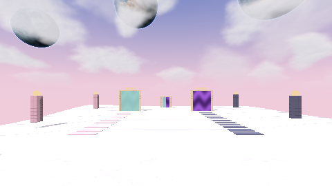 |
| 02 | [Cinco puertas al atardecer](Musica/02%20-%20Cinco%20puertas%20al%20atardecer.mp3) | El Umbral: Dreamcore y Dark Fantasy | 2:08 | 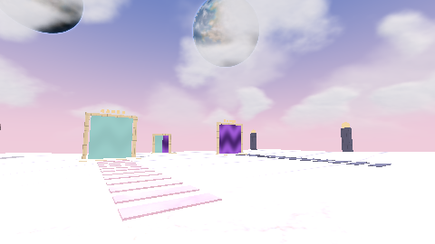 |
| 03 | [El agua conserva las voces](Musica/03%20-%20El%20agua%20conserva%20las%20voces.mp3) | Piscinas del recuerdo | 2:00 | 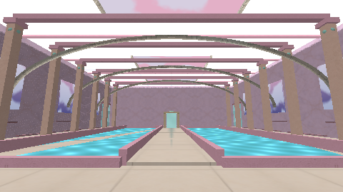 |
| 04 | [Casas que caen despacio](Musica/04%20-%20Casas%20que%20caen%20despacio.mp3) | El abismo de las casas perdidas | 2:24 | 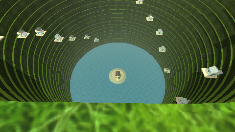 |
| 05 | [La lluvia olvidó el suelo](Musica/05%20-%20La%20lluvia%20olvid%C3%B3%20el%20suelo.mp3) | Los jardines de cristal dormido | 2:16 | 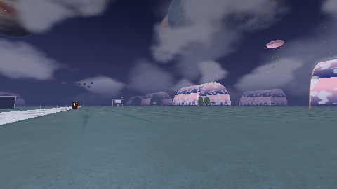 |
| 06 | [Alguien dejó la luz](Musica/06%20-%20Alguien%20dej%C3%B3%20la%20luz.mp3) | El pueblo de las ventanas despiertas | 1:56 | 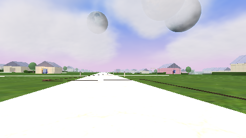 |
| 07 | [Mareas sobre las ventanas](Musica/07%20-%20Mareas%20sobre%20las%20ventanas.mp3) | El mar dentro del cielo | 2:12 | 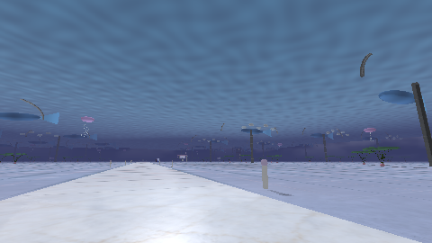 |
| 08 | [La puerta del fondo respira](Musica/08%20-%20La%20puerta%20del%20fondo%20respira.mp3) | La casa que recuerda otra puerta | 1:52 | 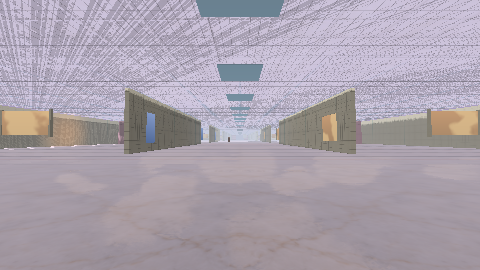 |
| 09 | [Una lámpara en el abismo](Musica/09%20-%20Una%20l%C3%A1mpara%20en%20el%20abismo.mp3) | La estación del último sueño | 2:08 | 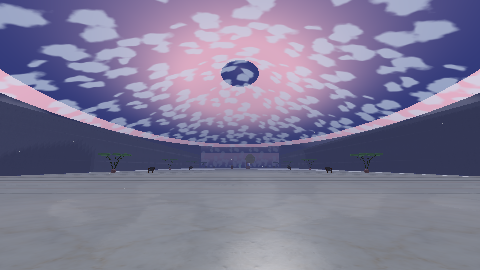 |
| 10 | [La partida sin contrincante](Musica/10%20-%20La%20partida%20sin%20contrincante.mp3) | La llanura de los reyes dormidos | 2:00 | 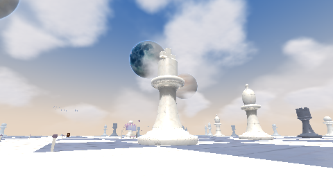 |
| 11 | [Porcelana que llora](Musica/11%20-%20Porcelana%20que%20llora.mp3) | El valle de las cúpulas de agua | 2:24 | 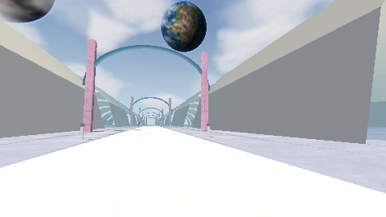 |
| 12 | [Habitaciones a la deriva](Musica/12%20-%20Habitaciones%20a%20la%20deriva.mp3) | El hotel de los horizontes | 2:16 | 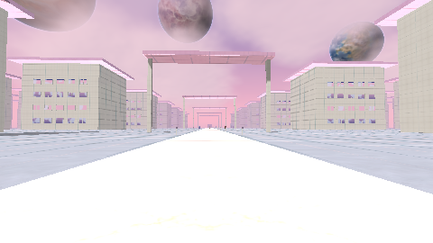 |
| 13 | [La curva que nadie recuerda](Musica/13%20-%20La%20curva%20que%20nadie%20recuerda.mp3) | La carretera donde caen estrellas | 1:56 | 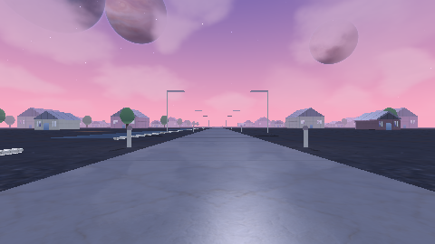 |
| 14 | [Lágrimas que sostienen el cielo](Musica/14%20-%20L%C3%A1grimas%20que%20sostienen%20el%20cielo.mp3) | El parque de las lágrimas suspendidas | 2:12 | 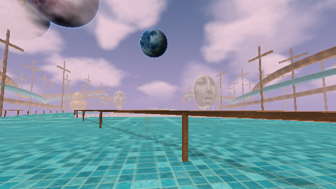 |
| 15 | [Órbitas de infancia](Musica/15%20-%20%C3%93rbitas%20de%20infancia.mp3) | El tobogán de los planetas | 1:52 | 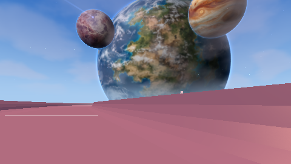 |
| 16 | [El recreo después del fin](Musica/16%20-%20El%20recreo%20despu%C3%A9s%20del%20fin.mp3) | La ciudad del último recreo | 2:08 | 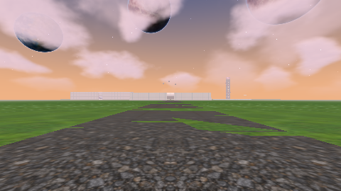 |
| 17 | [Sonríe cuando no miras](Musica/17%20-%20Sonr%C3%ADe%20cuando%20no%20miras.mp3) | El reino de las lunas dormidas | 2:00 | 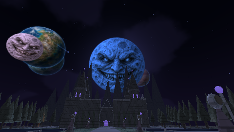 |
| 18 | [Flores para un trono vacío](Musica/18%20-%20Flores%20para%20un%20trono%20vac%C3%ADo.mp3) | El jardín de las coronas vacías | 2:24 | 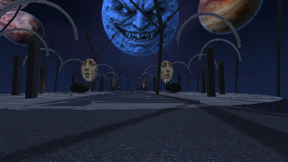 |
| 19 | [La ropa de otra vida](Musica/19%20-%20La%20ropa%20de%20otra%20vida.mp3) | Lavandería entre nubes | 2:16 | 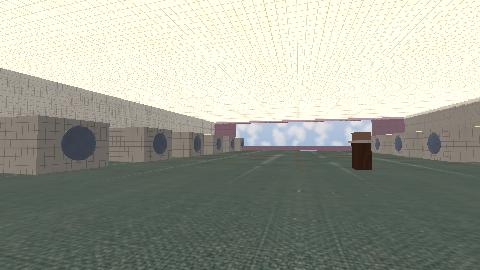 |
| 20 | [El último vagón sumergido](Musica/20%20-%20El%20%C3%BAltimo%20vag%C3%B3n%20sumergido.mp3) | El tren bajo el agua | 1:56 | 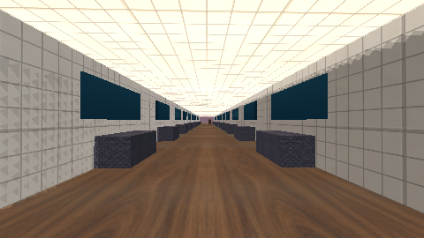 |
| 21 | [Las seis y nunca más](Musica/21%20-%20Las%20seis%20y%20nunca%20m%C3%A1s.mp3) | El amanecer que no termina | 2:12 | 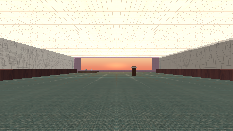 |
| 22 | [El horizonte tenía una escalera](Musica/22%20-%20El%20horizonte%20ten%C3%ADa%20una%20escalera.mp3) | La torre que viste desde lejos | 1:52 | 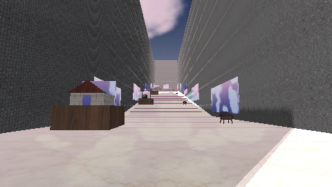 |
| 23 | [El peso azul del sueño](Musica/23%20-%20El%20peso%20azul%20del%20sue%C3%B1o.mp3) | Una cama al borde del universo | 2:08 | 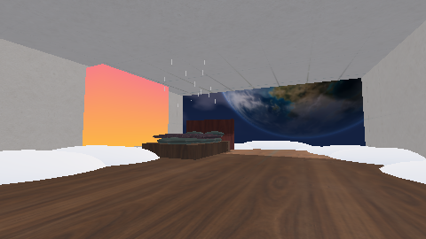 |
| 24 | [También pusieron tu taza](Musica/24%20-%20Tambi%C3%A9n%20pusieron%20tu%20taza.mp3) | La habitación que te espera | 2:00 | 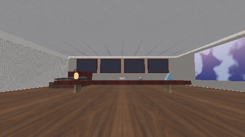 |
| 25 | [La casa antes de tu llegada](Musica/25%20-%20La%20casa%20antes%20de%20tu%20llegada.mp3) | Fotografía: la casa sin nadie | 2:24 | 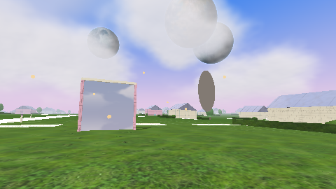 |
| 26 | [Una marea detenida en papel](Musica/26%20-%20Una%20marea%20detenida%20en%20papel.mp3) | Fotografía: el mar inmóvil | 2:16 | 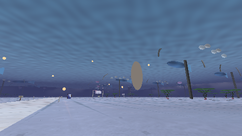 |
| 27 | [El cielo detrás del cristal](Musica/27%20-%20El%20cielo%20detr%C3%A1s%20del%20cristal.mp3) | Fotografía: las ventanas de ayer | 1:56 | 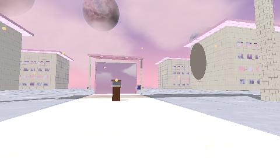 |
| 28 | [Una órbita en el álbum](Musica/28%20-%20Una%20%C3%B3rbita%20en%20el%20%C3%A1lbum.mp3) | Fotografía: el planeta detenido | 2:12 | 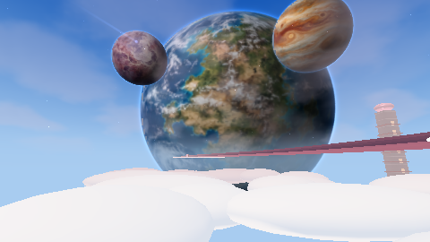 |
| 29 | [Dirección: nadie, nunca](Musica/29%20-%20Direcci%C3%B3n%20-%20nadie%2C%20nunca.mp3) | La casa del destinatario ausente | 1:52 | 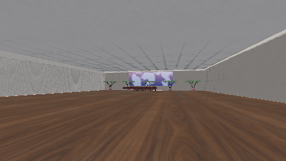 |
| 30 | [El techo aprende tus pasos](Musica/30%20-%20El%20techo%20aprende%20tus%20pasos.mp3) | El suelo que se volvió cielo | 2:08 | 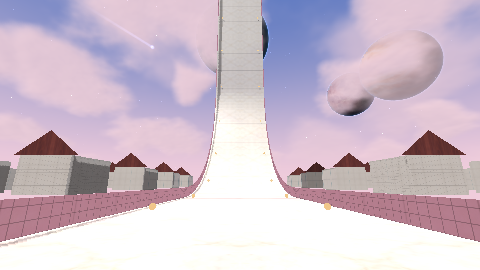 |
| 31 | [Calles que se doblan al dormir](Musica/31%20-%20Calles%20que%20se%20doblan%20al%20dormir.mp3) | El barrio que se inclinó | 2:00 | 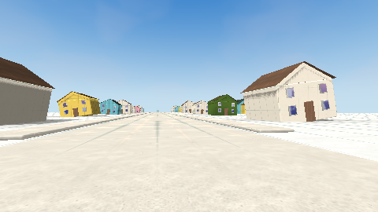 |
| 32 | [La película que mira la Tierra](Musica/32%20-%20La%20pel%C3%ADcula%20que%20mira%20la%20Tierra.mp3) | El cine sobre la Tierra | 2:24 | 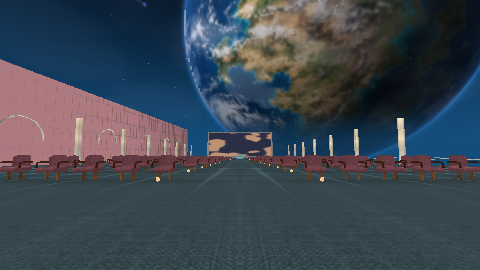 |
| 33 | [Duchas para un valle vacío](Musica/33%20-%20Duchas%20para%20un%20valle%20vac%C3%ADo.mp3) | Las duchas del valle infinito | 2:16 | 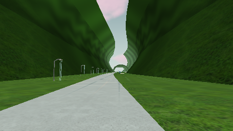 |
| 34 | [El reflejo llegó primero](Musica/34%20-%20El%20reflejo%20lleg%C3%B3%20primero.mp3) | La casa reflejada entre nubes | 1:56 | 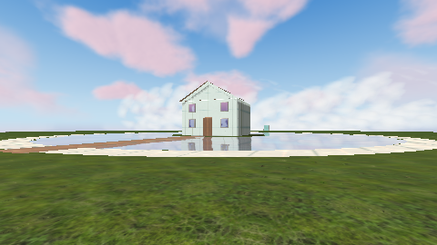 |
| 35 | [Los hongos sueñan bajo el canal](Musica/35%20-%20Los%20hongos%20sue%C3%B1an%20bajo%20el%20canal.mp3) | El canal de los hongos dormidos | 2:12 | 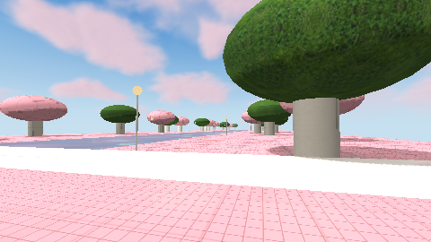 |
| 36 | [Una nube ocupa todo el día](Musica/36%20-%20Una%20nube%20ocupa%20todo%20el%20d%C3%ADa.mp3) | La colina de la nube inmensa | 1:52 | 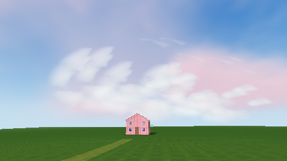 |
| 37 | [Nadie viene a repostar](Musica/37%20-%20Nadie%20viene%20a%20repostar.mp3) | La última gasolinera del atardecer | 2:08 | 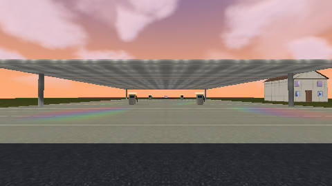 |
| 38 | [Sombras que eligieron otro color](Musica/38%20-%20Sombras%20que%20eligieron%20otro%20color.mp3) | El barrio de las sombras de colores | 2:00 | 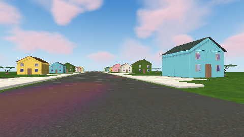 |
| 39 | [Reservamos una silla para ti](Musica/39%20-%20Reservamos%20una%20silla%20para%20ti.mp3) | El pasillo de las sillas vacías | 2:24 | 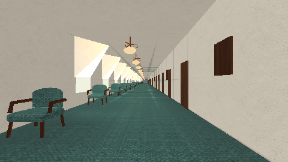 |
| 40 | [Entre los pisos falta un nombre](Musica/40%20-%20Entre%20los%20pisos%20falta%20un%20nombre.mp3) | El edificio de los pisos sin nadie | 2:16 | 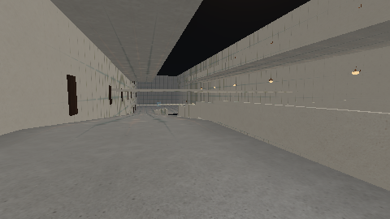 |
| 41 | [El archivo de las nubes](Musica/41%20-%20El%20archivo%20de%20las%20nubes.mp3) | La oficina dentro de las nubes | 1:56 | 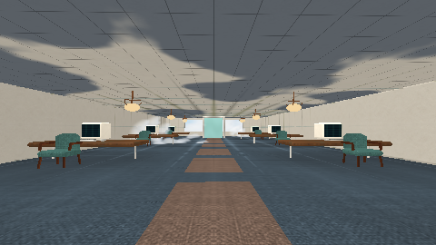 |
| 42 | [El campo sabe que estás aquí](Musica/42%20-%20El%20campo%20sabe%20que%20est%C3%A1s%20aqu%C3%AD.mp3) | Vista previa: la pradera que te mira | 2:12 | 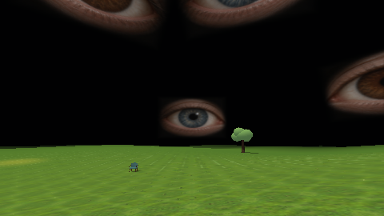 |
| 43 | [La casa rosa al final del aire](Musica/43%20-%20La%20casa%20rosa%20al%20final%20del%20aire.mp3) | La casa rosa sobre el océano | 1:52 | 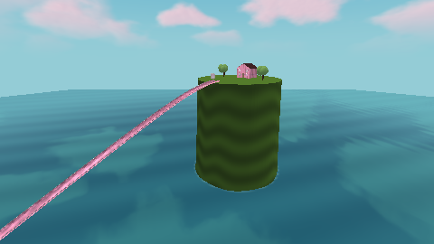 |
| 44 | [Cuarenta y nueve habitaciones despiertas](Musica/44%20-%20Cuarenta%20y%20nueve%20habitaciones%20despiertas.mp3) | Backrooms: las luces que no descansan | 2:08 | 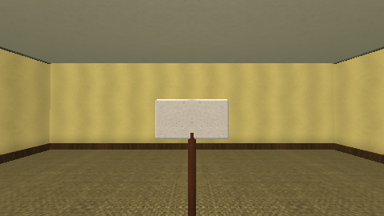 |
| 45 | [Donde el cielo dejó una abertura](Musica/45%20-%20Donde%20el%20cielo%20dej%C3%B3%20una%20abertura.mp3) | Las aberturas del cielo | 2:00 | 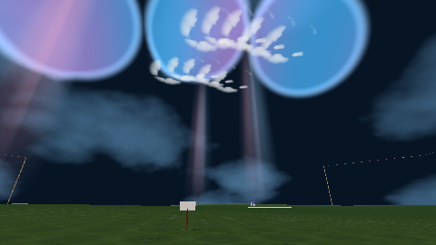 |
| 46 | [Un castillo en el aliento](Musica/46%20-%20Un%20castillo%20en%20el%20aliento.mp3) | Los corredores del castillo de nubes | 2:24 | 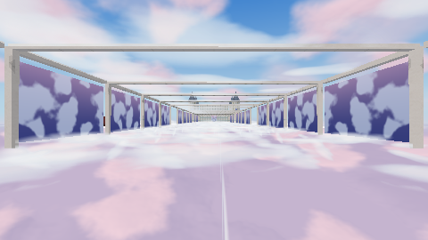 |
| 47 | [El tren cruza las flores](Musica/47%20-%20El%20tren%20cruza%20las%20flores.mp3) | La ciudad al otro lado de las flores | 2:16 | 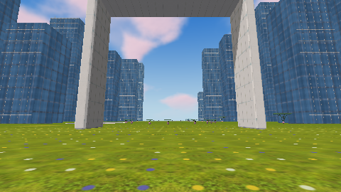 |
| 48 | [Un puente entre dos silencios](Musica/48%20-%20Un%20puente%20entre%20dos%20silencios.mp3) | La pradera de las grietas | 1:56 | 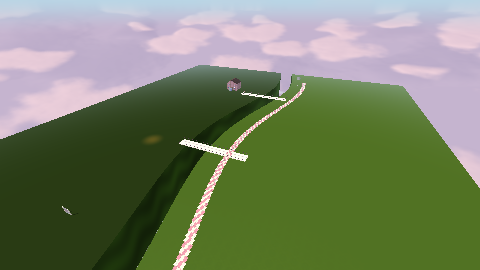 |
| 49 | [La llamada venía de adentro](Musica/49%20-%20La%20llamada%20ven%C3%ADa%20de%20adentro.mp3) | La casa del teléfono desconectado | 2:12 | 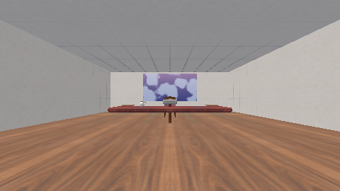 |
