# DreamCore 2.5 · Comparación del renderizado

Vistas generadas con las mallas, texturas y shaders GLES2 del juego en Mesa. Misma cámara y momento para antes/después. Son renders del motor en un PC, no capturas de un teléfono. Las ilustraciones del álbum se usan como dirección artística y representan un acabado al que todavía aspiramos.

## Comparación

### Pasillo de las sillas vacías

| 2.4 | 2.5 |
| --- | --- |
| 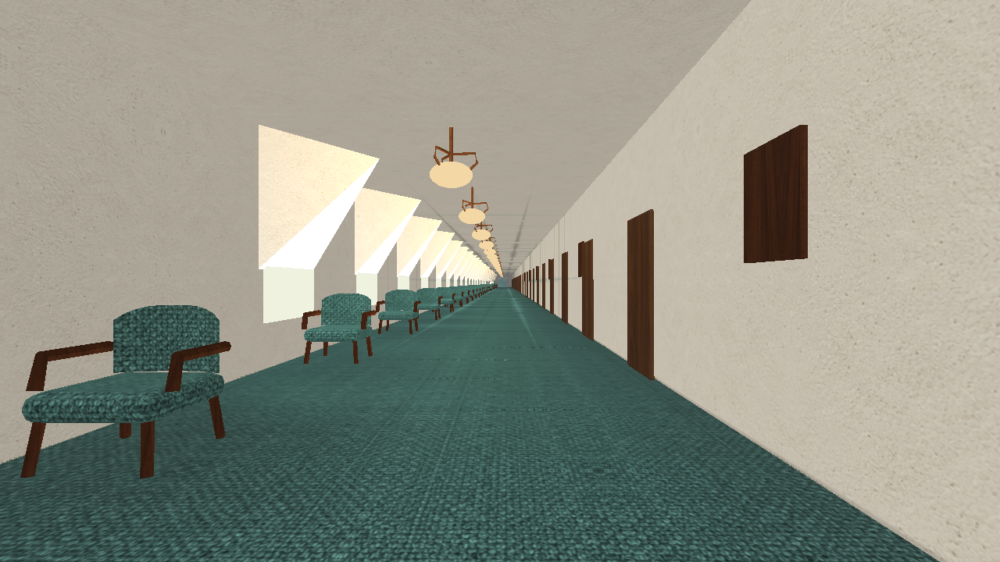 | 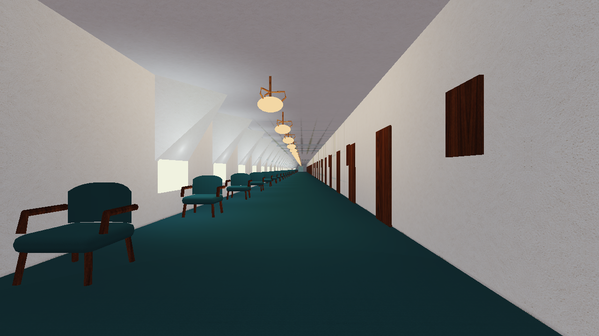 |

### Piscinas del recuerdo

| 2.4 | 2.5 |
| --- | --- |
| 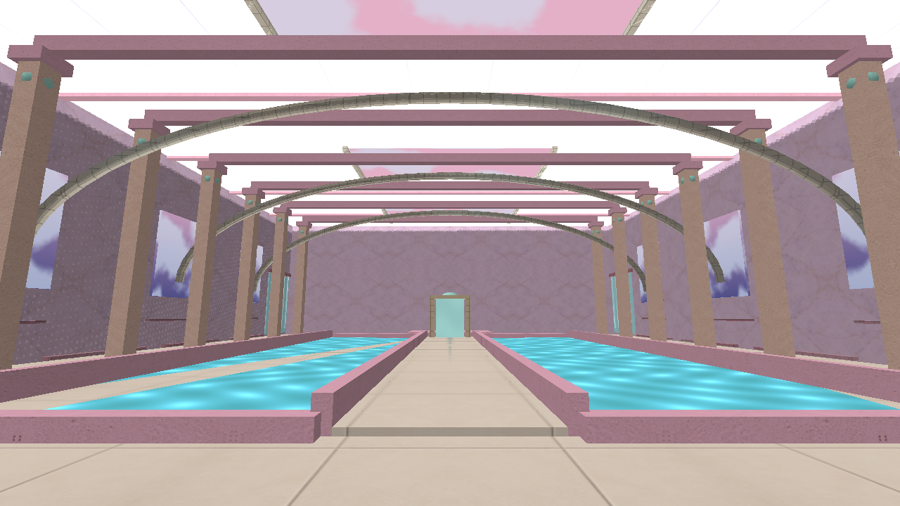 | 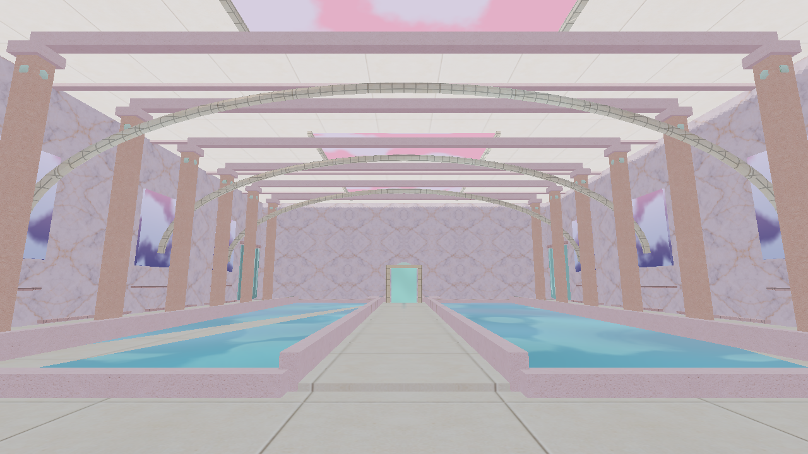 |

### El pueblo

| 2.4 | 2.5 |
| --- | --- |
| 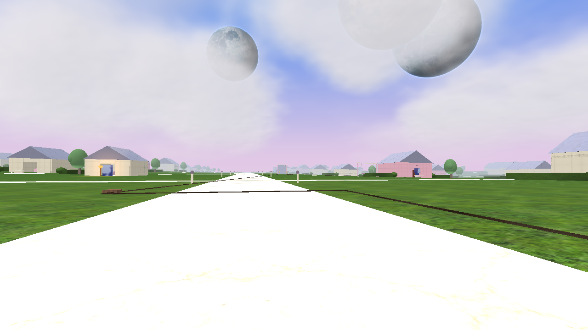 | 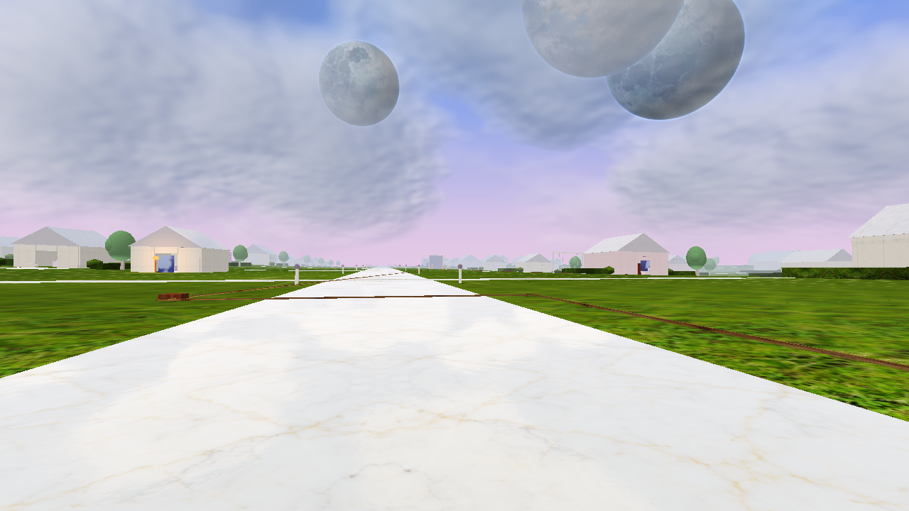 |

## Otros escenarios revisados

### Oficina entre nubes

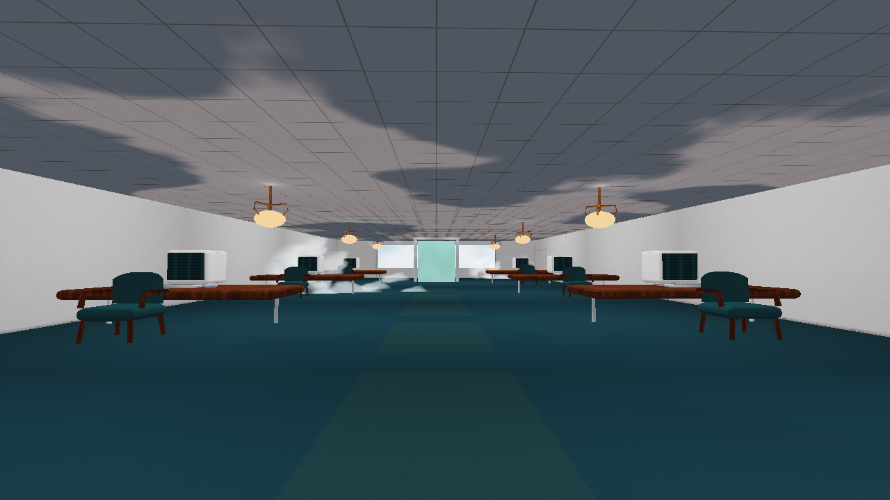

### Abismo de las casas

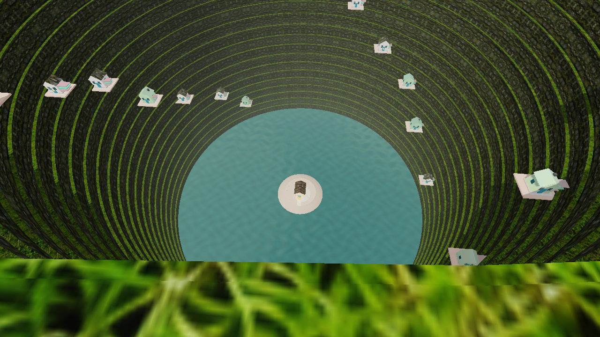

### Reino de las lunas

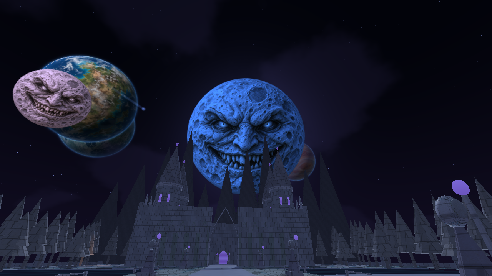

### Casa rosa sobre el océano

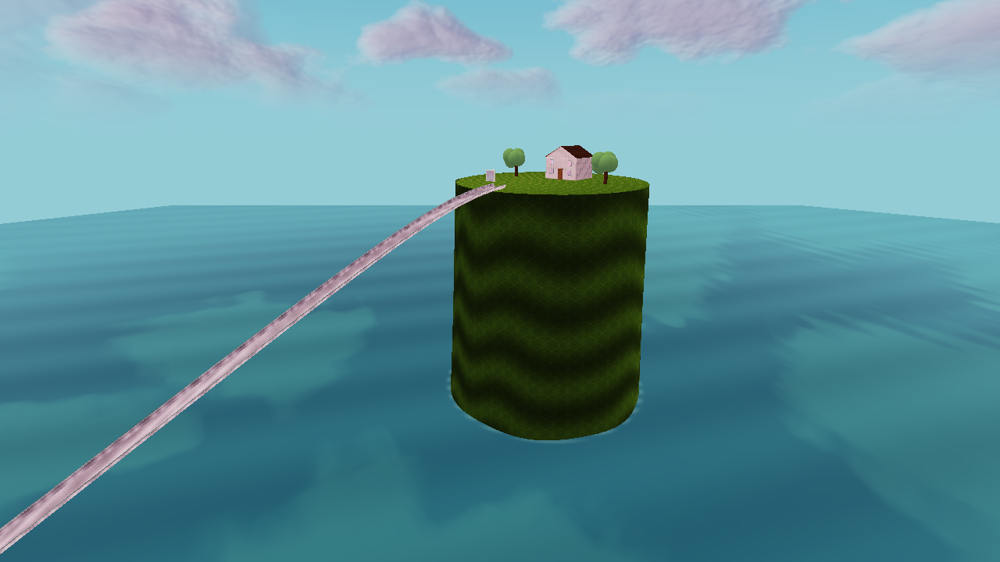

### Backrooms

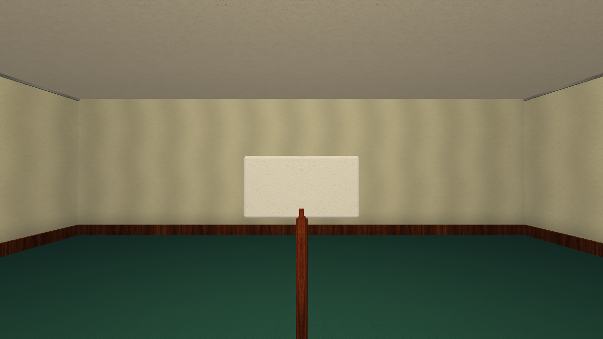

[Instalar la actualización](LEEME.md) · [Validación](VALIDACION.json)
