# DreamCore 2.6 · vistas del motor

Mallas y texturas entregadas, dibujadas con los shaders GLES2 en Mesa. Incluyen la nube volumétrica a media resolución, la oclusión de contacto y FXAA del modo Media. No son ilustraciones ni capturas de un teléfono. Las parejas mantienen cámara y tiempo; cada versión usa su propia geometría real.

## Piscinas

2.5:
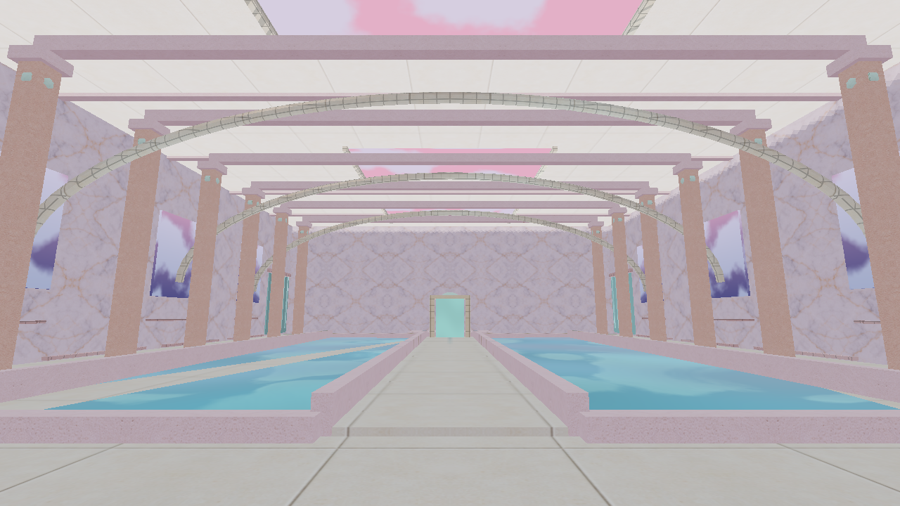

2.6: claraboyas abiertas, columnas redondas, bordes modelados, mosaico sumergido y reflejo de la sala.
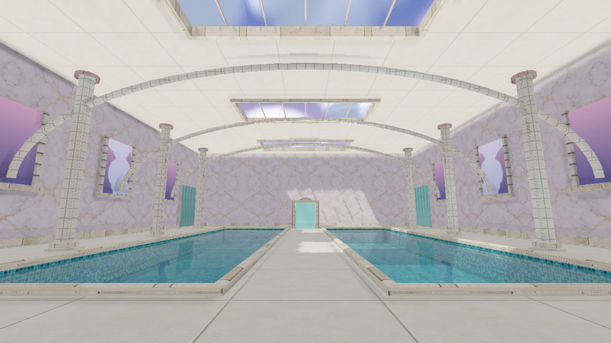

## Mirar el agua de cerca

2.5:
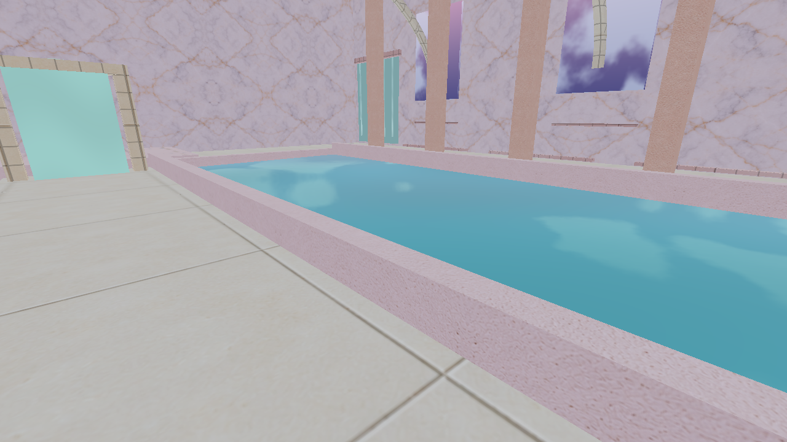

2.6:
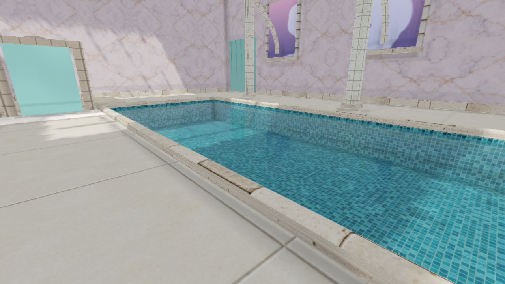

## Casas y vegetación del pueblo

2.5:
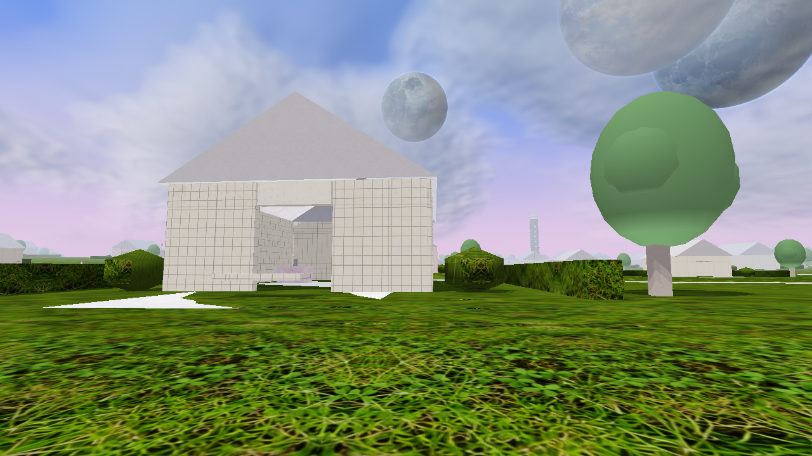

2.6: tejados, remates, ventanas y copas de hojas recortadas.
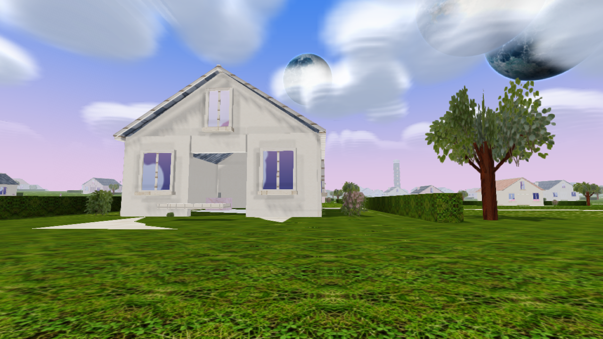

Vista del recorrido:
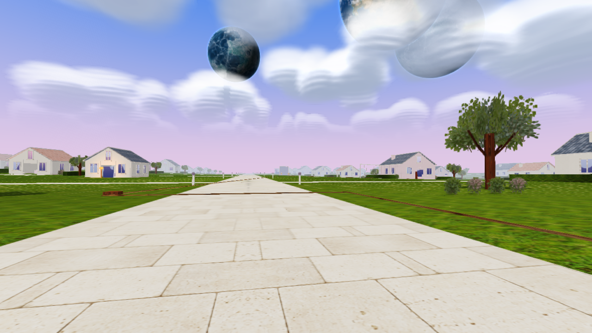

## Cielo

2.5:
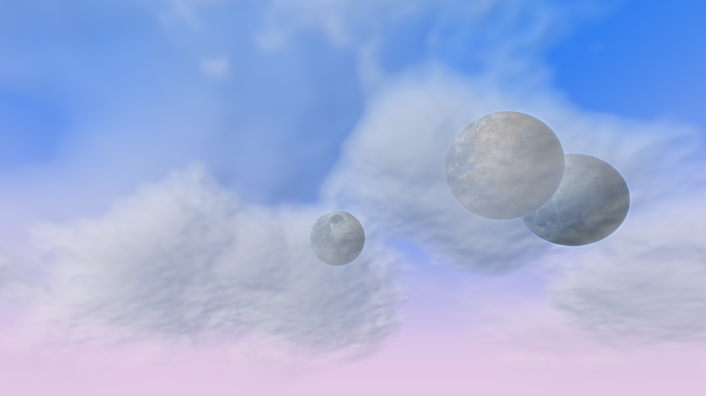

2.6: volumen precalculado, iluminación interna y desplazamiento mundial. Los planetas permanecen en la pasada de resolución normal.
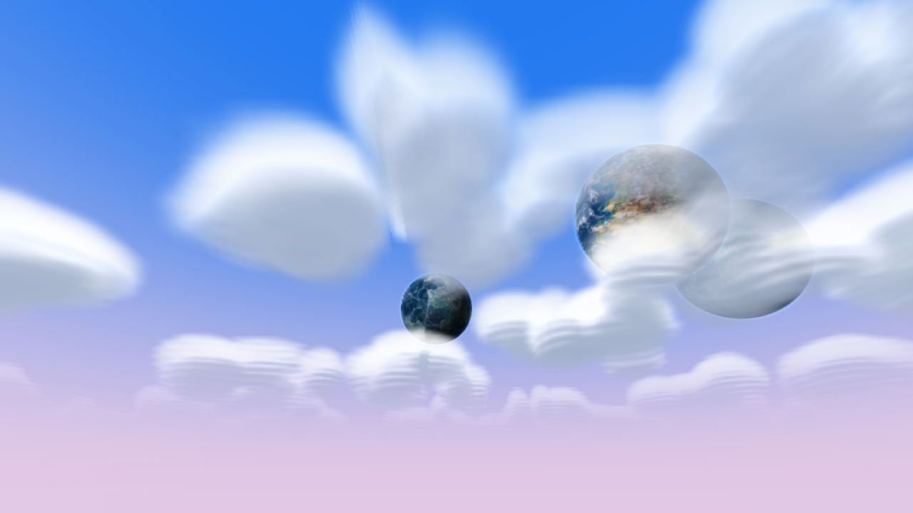

## Otros escenarios

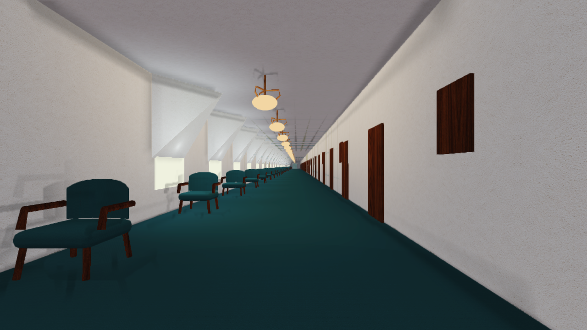
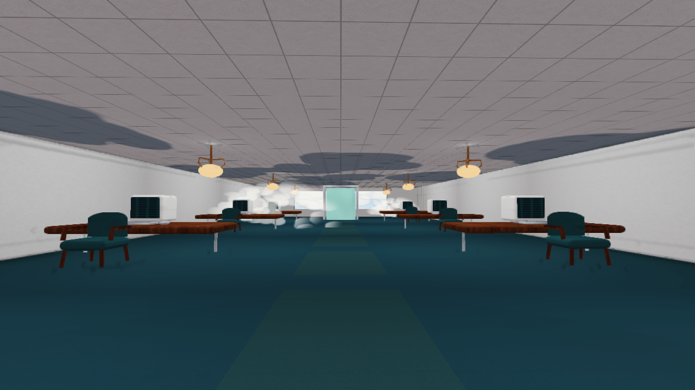

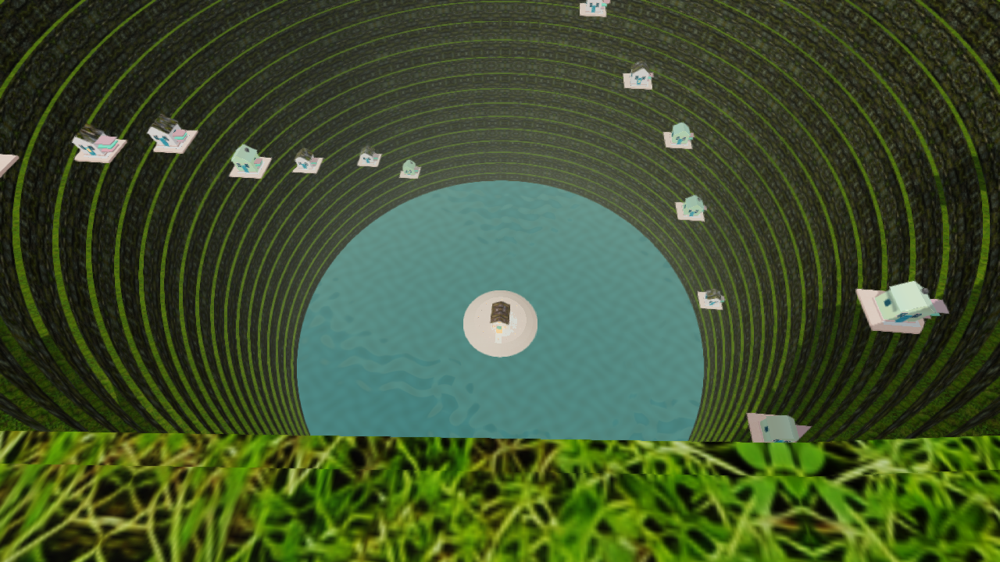
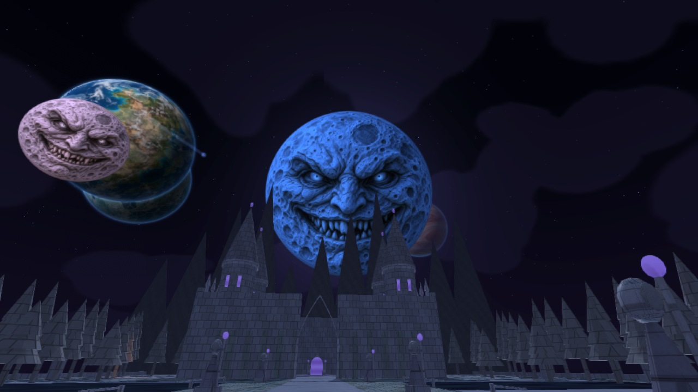
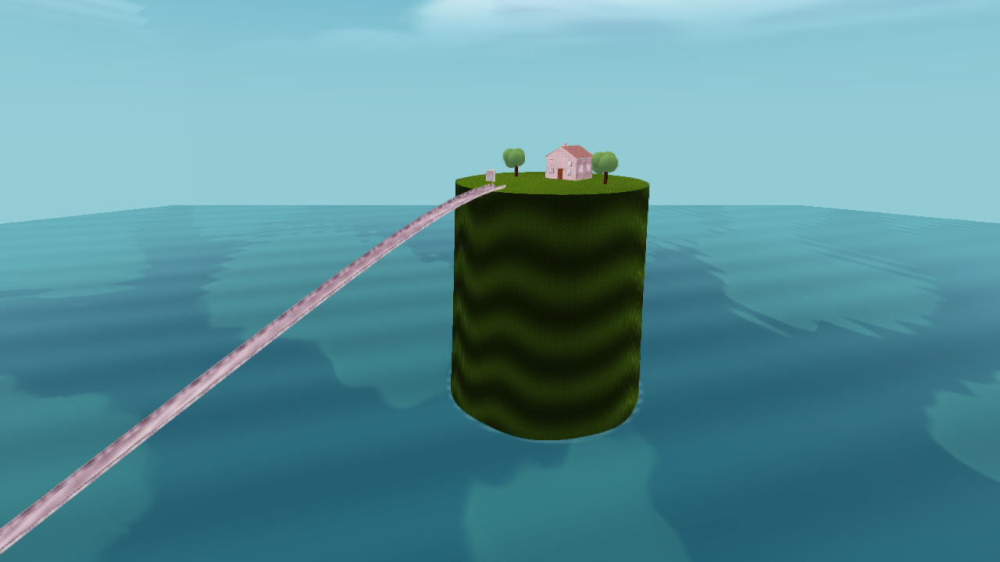
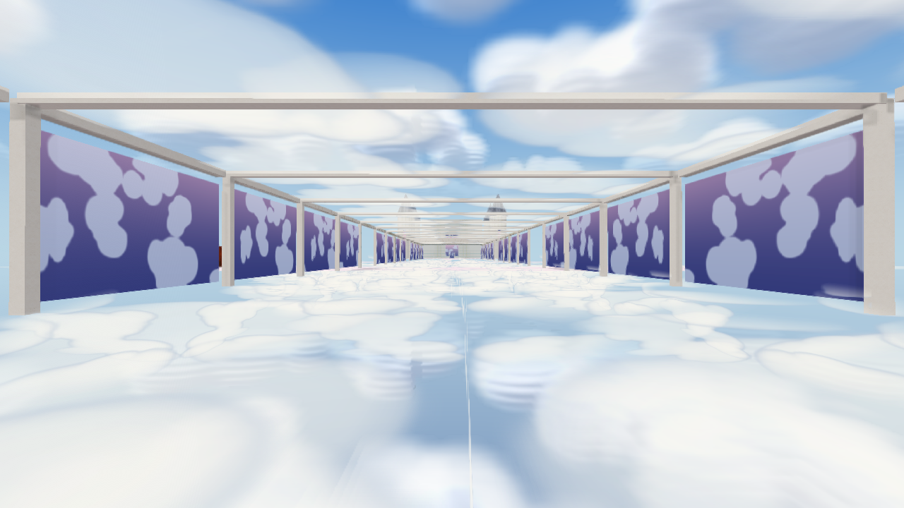

Los modelos de estos otros escenarios no se han reconstruido todos. La cobertura de pruebas y los costes están en [LEEME.md](LEEME.md) y [RENDIMIENTO_2_6.txt](RENDIMIENTO_2_6.txt). Las portadas ilustradas siguen siendo la dirección artística; esta entrega no afirma reproducir exactamente su acabado.
