# Vistas de DreamCore 2.7

Imágenes de la geometría y los programas OpenGL ES 2.0 que se entregan con el juego, renderizadas con Mesa. No son capturas de un teléfono ni ilustraciones de una versión futura.

## Lunas y sus tiempos

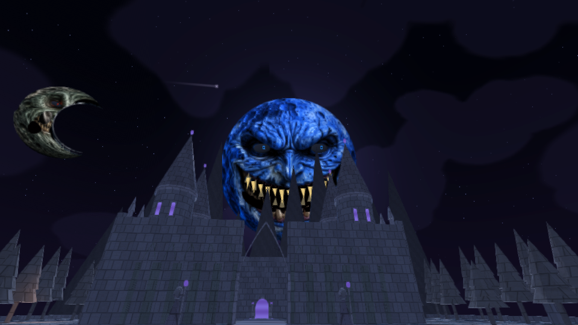
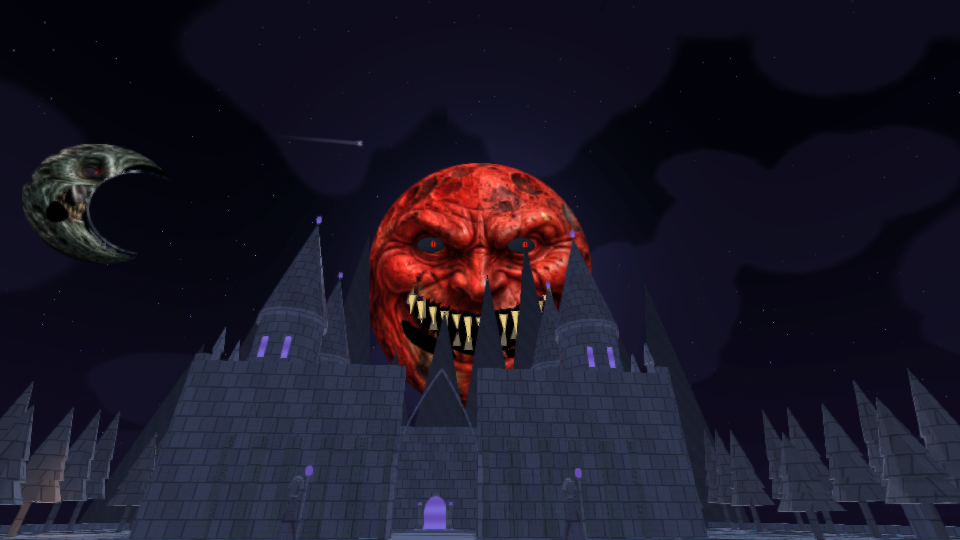

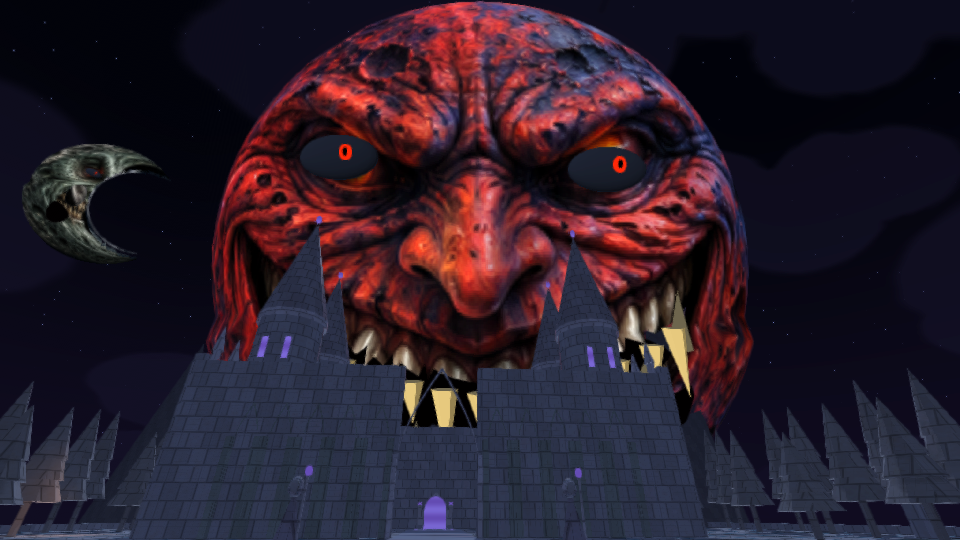

## Mundos nuevos

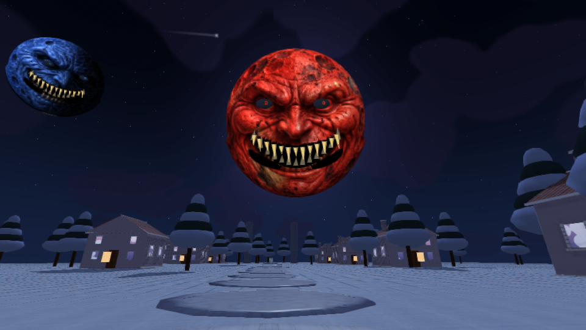
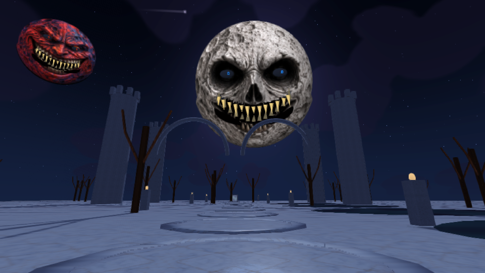
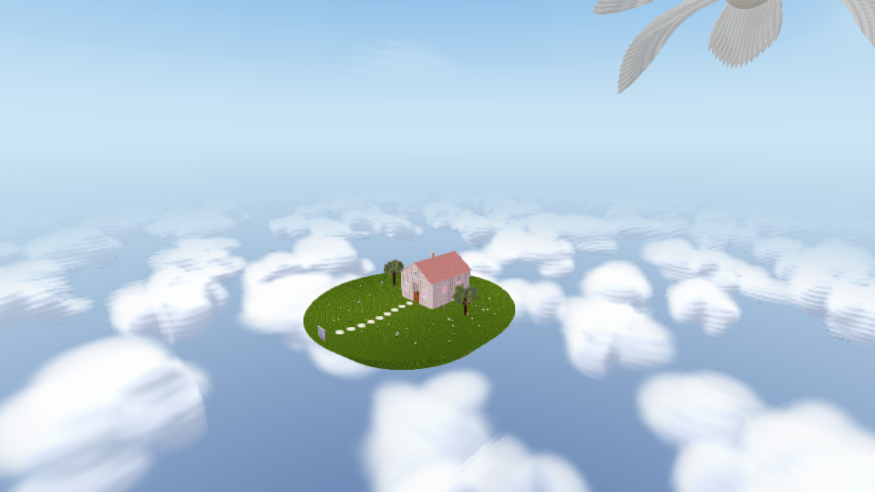
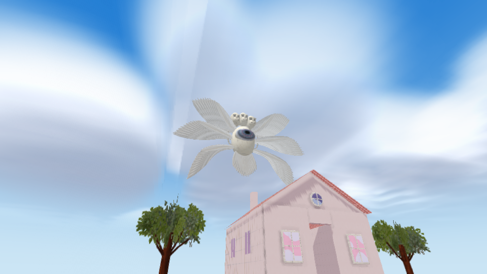

## Criaturas en reposo

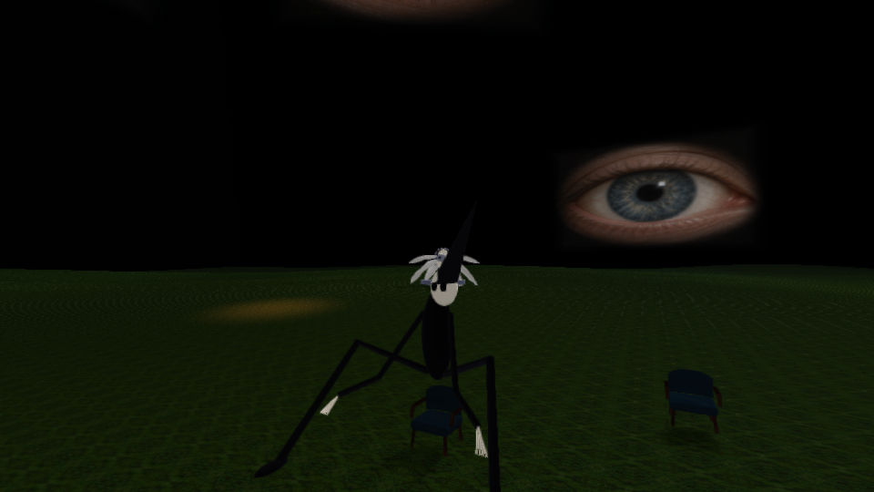
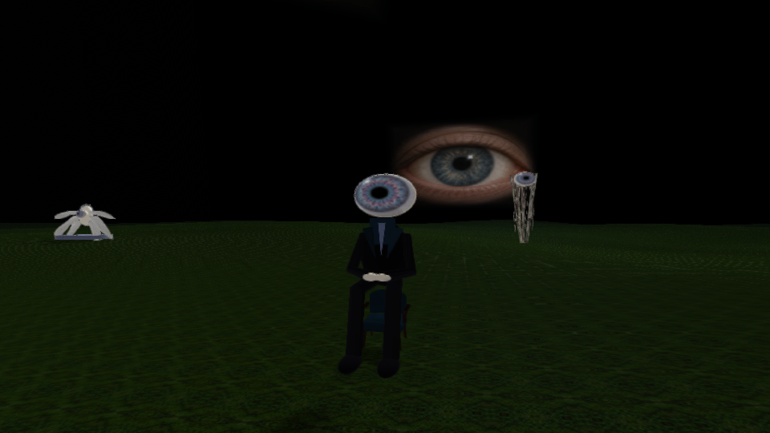
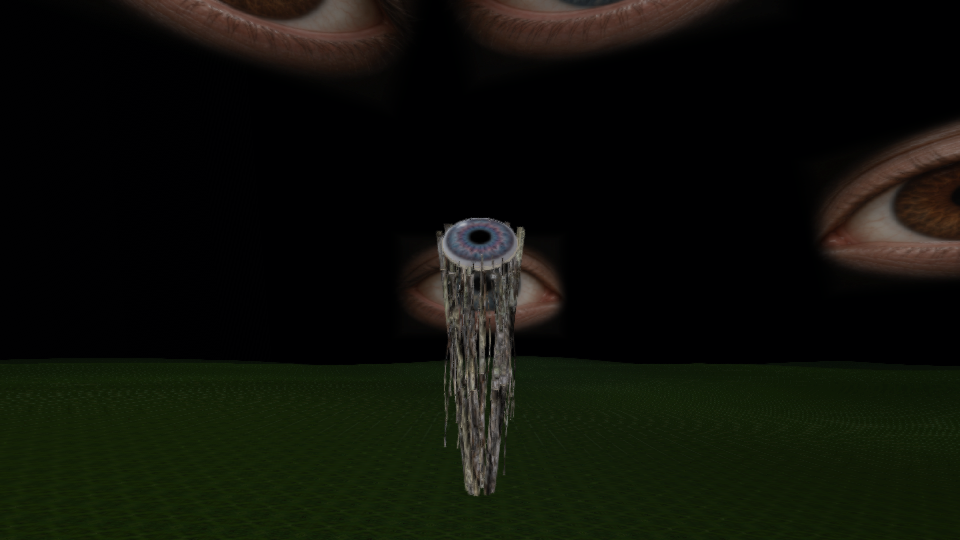
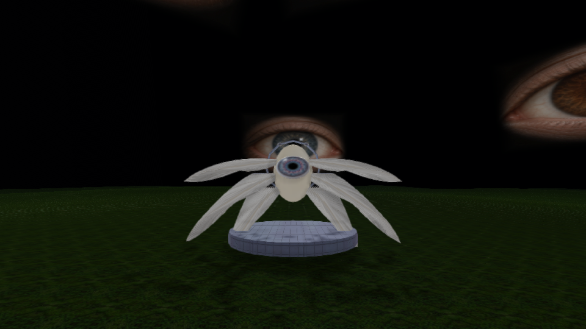
