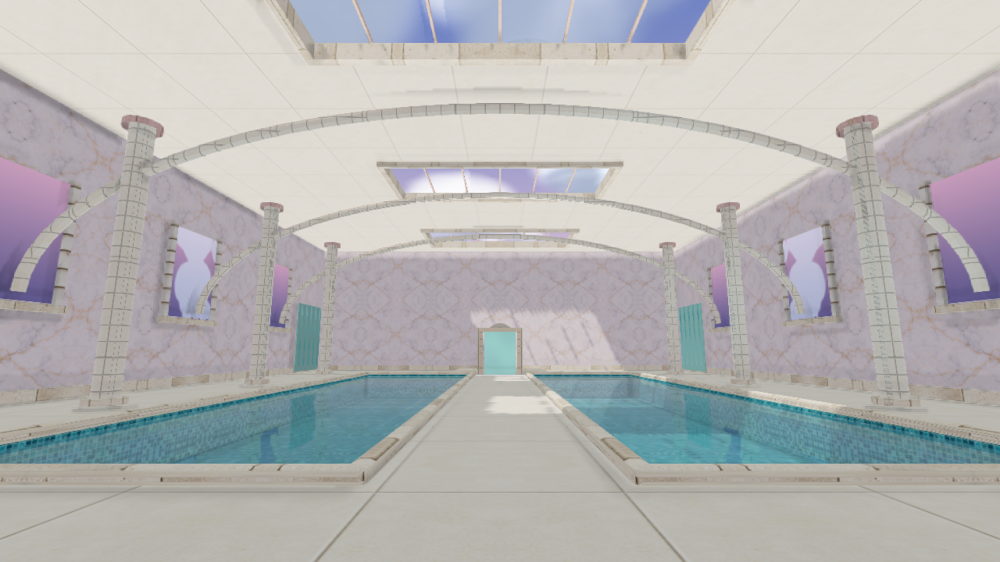
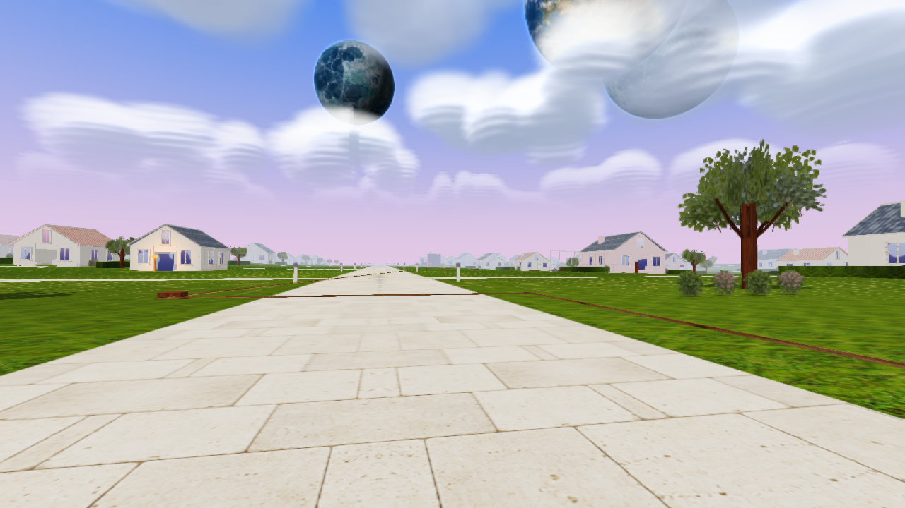
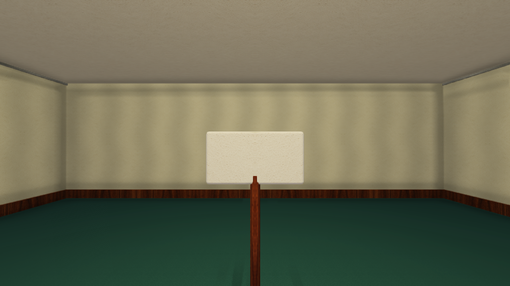
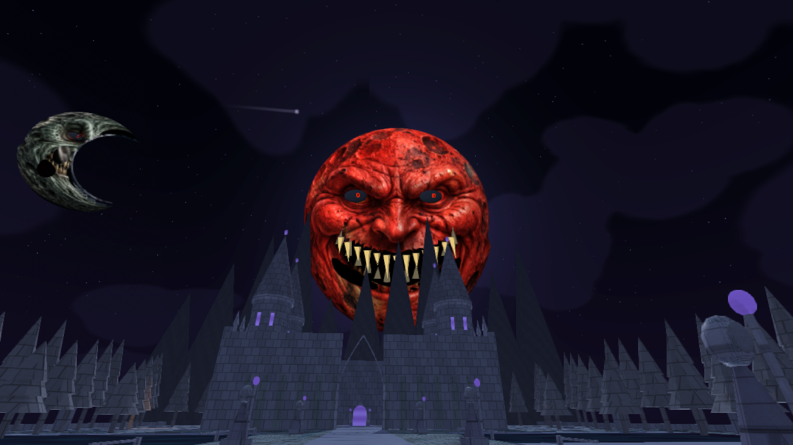
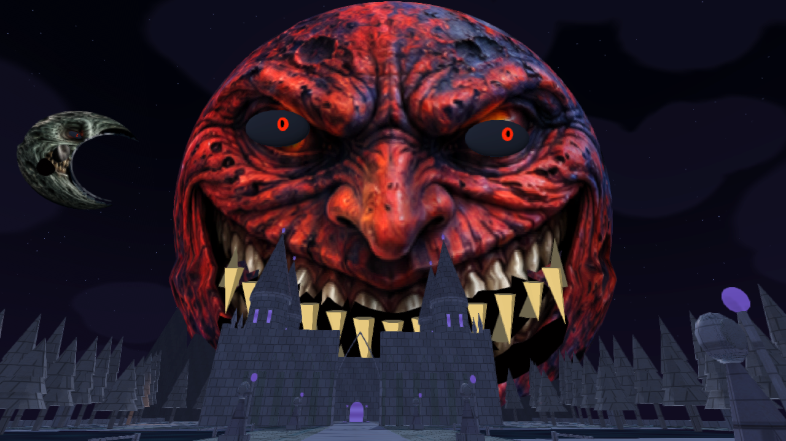
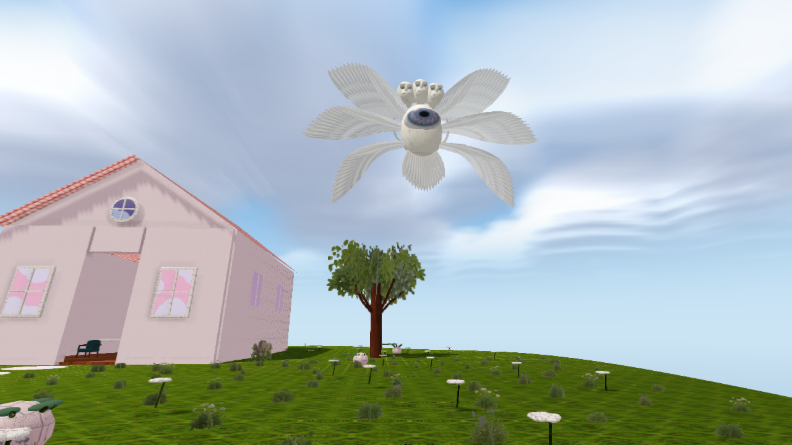

# Comparación visual · 2.7 y 2.8

Las dos versiones se renderizan con la misma geometría, cámara, resolución y momento. Son imágenes directas del motor con OpenGL ES 2.0/Mesa; no son capturas de un teléfono ni portadas ilustradas. Las optimizaciones mantienen los modelos, materiales e iluminación.

## Piscinas

Antes, 2.7:

Después, 2.8:

## Pueblo

## Backrooms

## Luna roja al minuto

## Luna gigante a los dos minutos

## Isla y observador

La comparación numérica de todos los escenarios y las alternativas de calidad está en `tools/validacion28`. Los tiempos de referencia se describen en `RENDIMIENTO_2_8.txt`.
