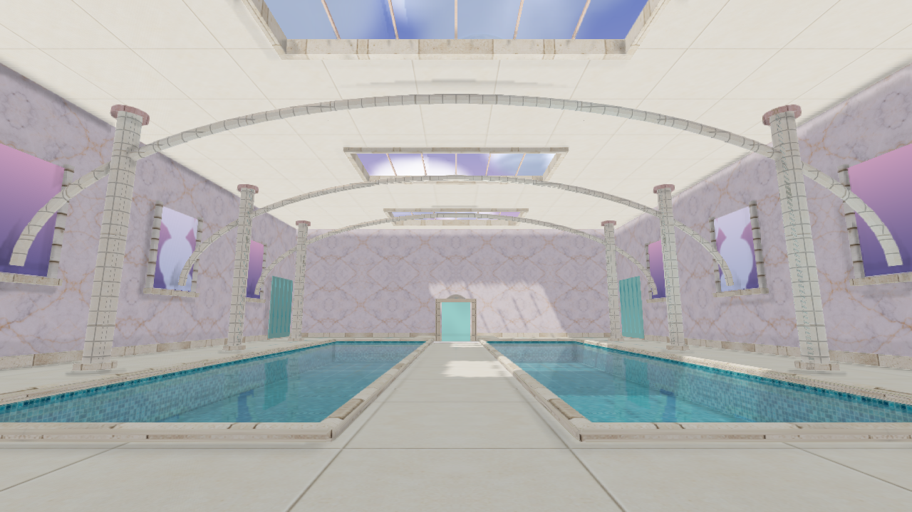
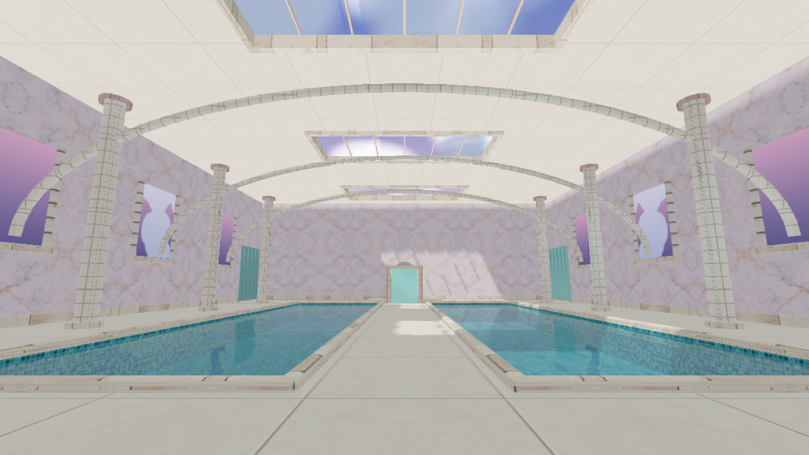
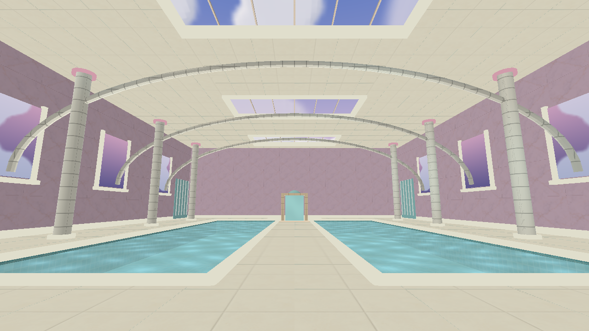
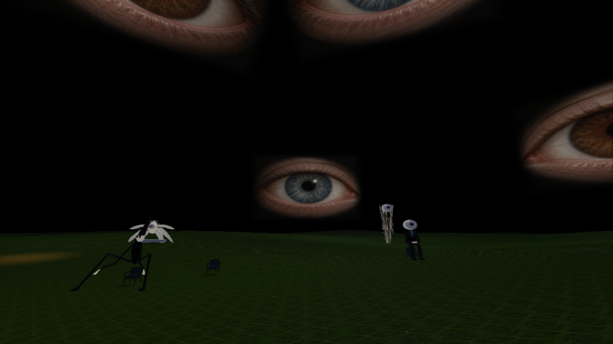
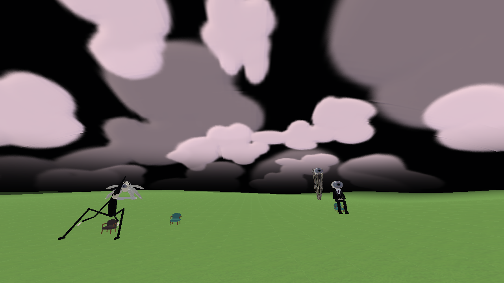
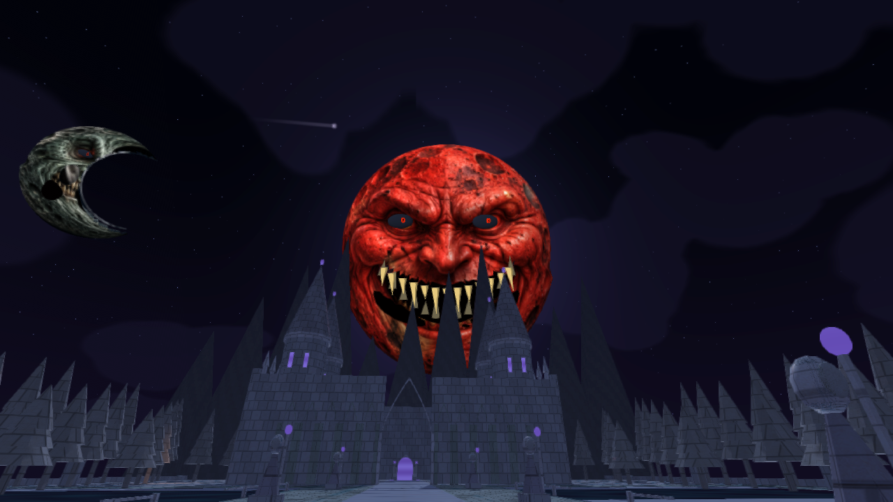
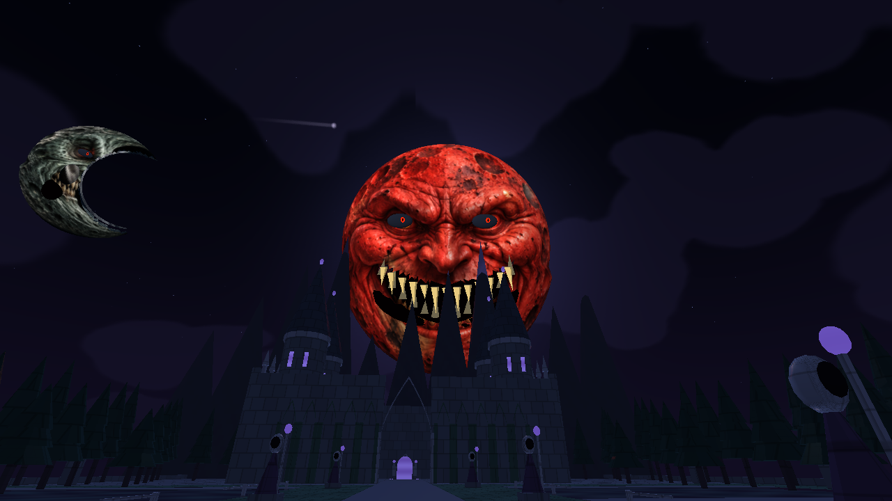
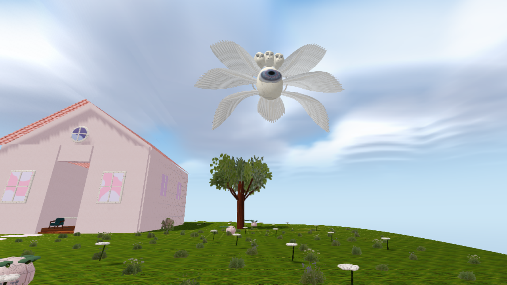
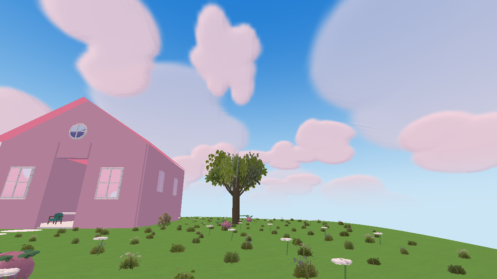

# Vistas de los tres perfiles · 2.9

Imágenes directas del motor GLES2/Mesa a 1280×720, con la misma cámara por escenario. No son capturas de POCO/Redmi. Completo usa profundidad comprobada y oclusión de contacto; Estable evita esa lectura; Esencial usa iluminación simplificada. Los materiales y modelos de origen se mantienen.

## Piscinas

Completo:

Estable:

Esencial:

## Pradera de ojos

Completo:

Estable:

Esencial:

## Luna roja al minuto

Completo:

Estable:

Esencial:

## Isla celeste

Completo:

Estable:

Esencial:

