# DreamCore 3.0 · Vistas del motor

Escenas reales renderizadas con las mallas, materiales y shaders del juego en GLES2 Mesa. Se muestran estados alcanzables de las interacciones; no son promesas de rendimiento en un teléfono.

## Luna azul remodelada

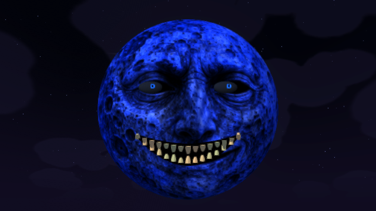

## Cambio a rojo tras observarla

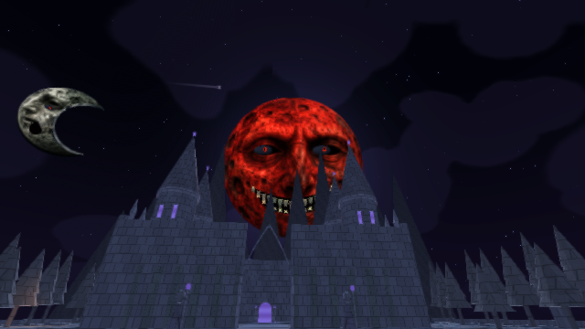

## Párpados cerrados

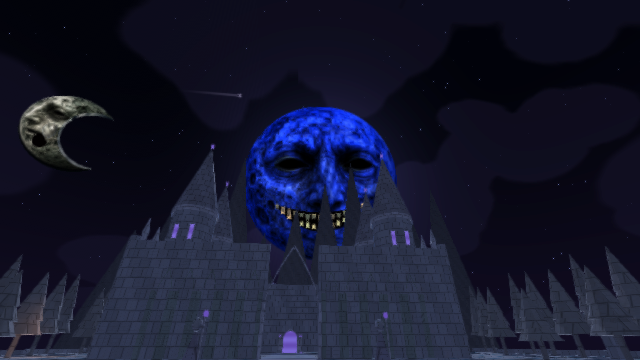

## Aparición gigante

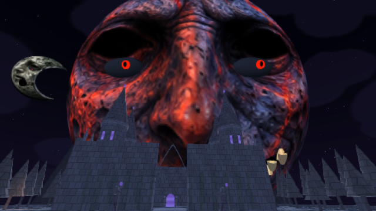

## Luna creciente

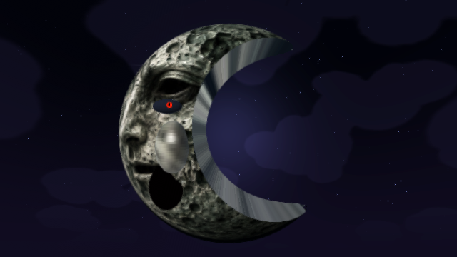

## Biblioteca

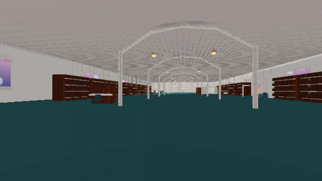

## Piano interactivo

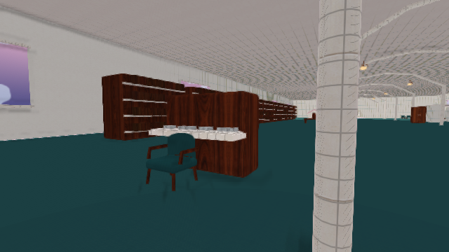

## Habitación proyectada

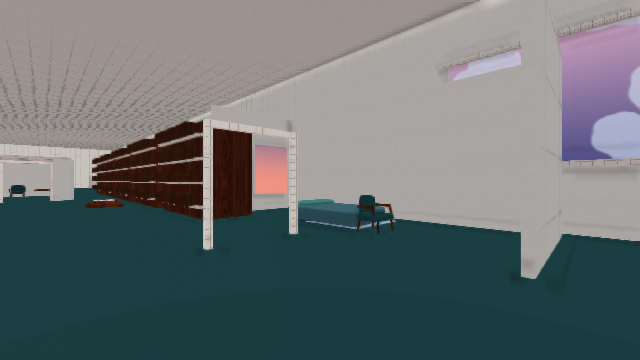

## Maqueta

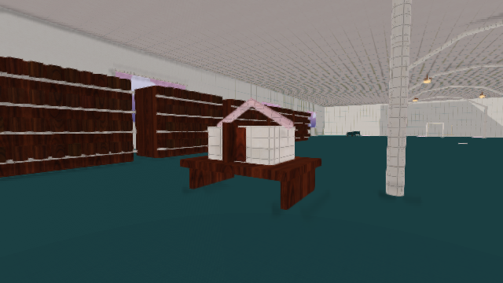

## Feria detenida

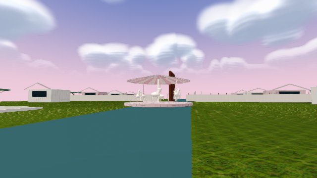

## Depósito

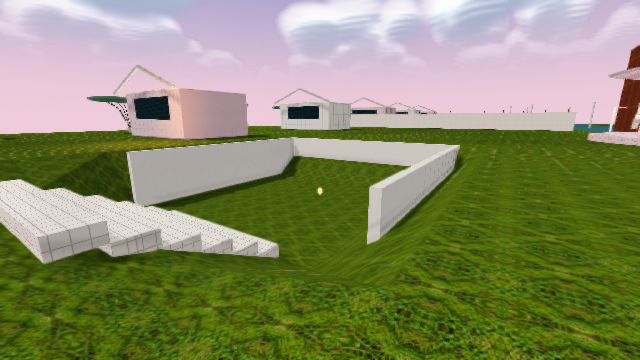

## Parada sin cartel

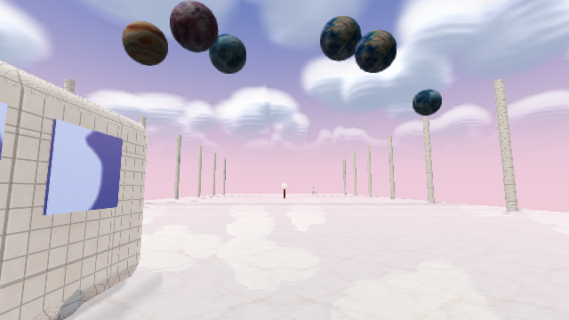

## Estación pálida del otro billete

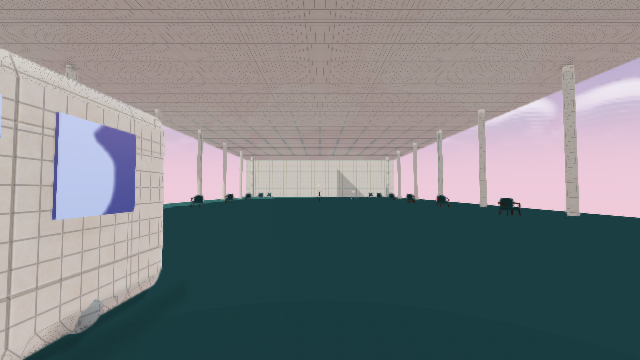

## Refugio y objetos

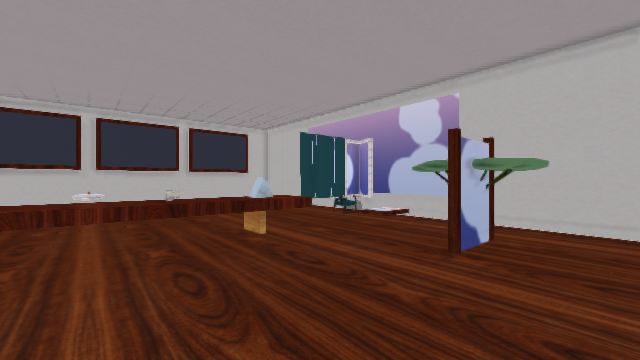

## Vagón de viaje

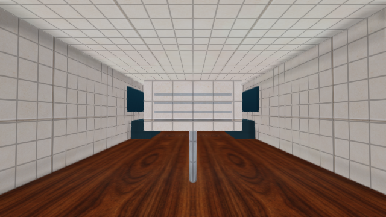
