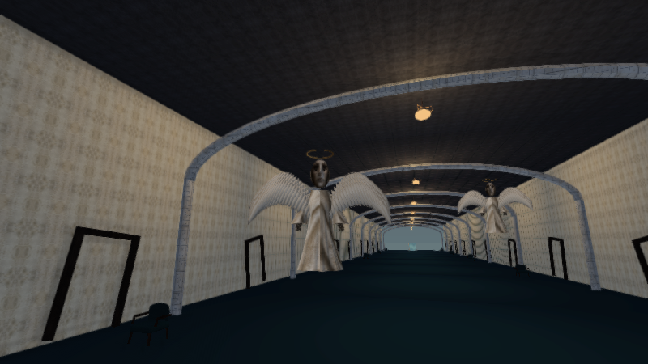
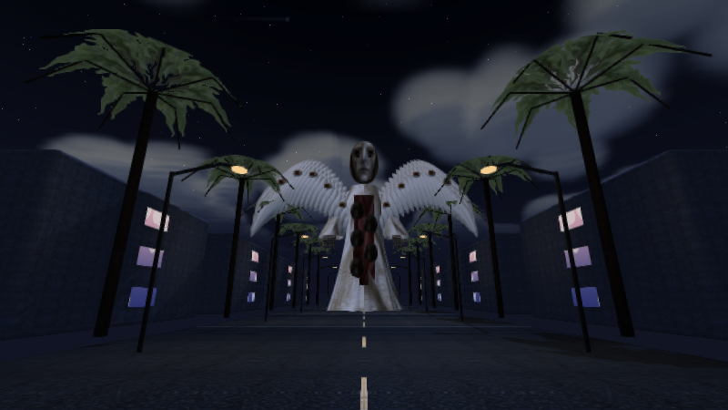
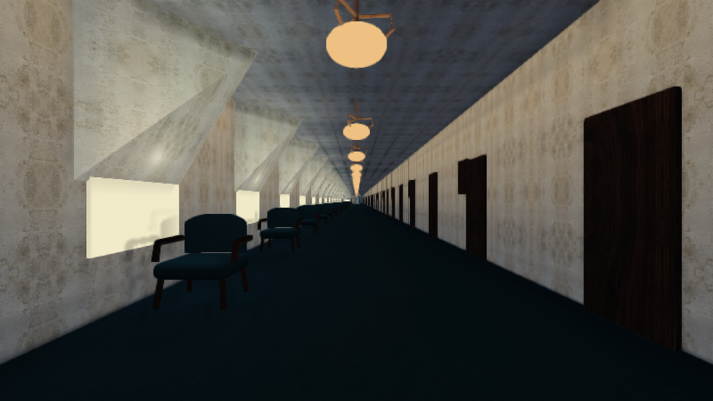

# Vistas del juego 3.1

Imágenes calculadas con los modelos, texturas y programas GLES2 de esta entrega mediante Mesa. Son vistas del motor, no portadas ilustradas ni capturas de un teléfono. Se revisaron 142 vistas, cubriendo los 61 escenarios en los perfiles Estable y Esencial; esta carpeta incluye una selección.

| Lugar o modelo | Vista |
| --- | --- |
| Observatorio ocular | [El jardín de las antenas](vistas31/antenas.png) |
| Observador enmascarado | [El camino de los testigos](vistas31/calle.png) |
| Eclipse y alas carmesíes | [El bosque del sol vacío](vistas31/eclipse.png) |
| Pantallas y hongos | [El herbario](vistas31/pantallas.png) |
| Isla y depresión circular | [La casa del hilo](vistas31/casa.png) |
| Piscina y ojos del agua | [La piscina del horizonte](vistas31/costa.png) |
| Figura con traje y ojo | [La cabeza de estrella](vistas31/estrella.png) |
| Atrio anterior | [Los pisos sin nadie](vistas31/atrium.png) |
| Barrio anterior | [El barrio inclinado](vistas31/barrio.png) |
| Dark Fantasy anterior | [Las lunas dormidas](vistas31/castillo.png) |
| Umbral anterior | [El Umbral](vistas31/umbral.png) |
| Oficina anterior | [La oficina](vistas31/oficina.png) |
| Cine anterior | [El cine](vistas31/cine.png) |

Comparaciones de perfil: [coro Estable](vistas31/coro_estable.png), [coro Esencial](vistas31/coro_esencial.png), [pasillo Estable](vistas31/sillas_estable.png), [pasillo Esencial](vistas31/sillas_esencial.png), [testigo Estable](vistas31/testigo_estable.png), [testigo Esencial](vistas31/testigo_esencial.png).

Los perfiles conservan la geometría y los encuentros. Esencial usa la iluminación compatible y prescinde de efectos de profundidad; por ello las vistas no tienen que ser idénticas. [Resultados y límites](RENDIMIENTO_3_1.md).
