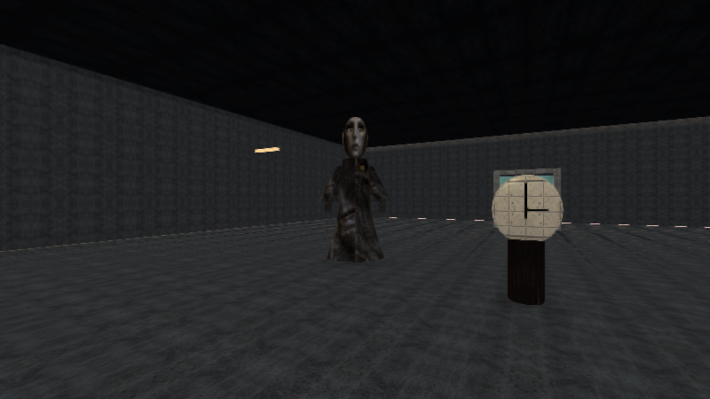
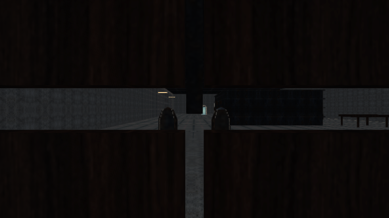

# Vistas del motor · 3.2

Se comprobaron **154 vistas GLES2/Mesa**: los 62 mundos en Estable y Esencial, más diez encuadres del capítulo en tres perfiles. Las imágenes usan geometrías, materiales y shaders de la entrega. No son capturas de teléfonos ni portadas ilustradas.

| Lugar o acción | Imagen |
| --- | --- |
| La carta del Umbral | [Reloj inicial](vistas33/umbral_completo.png) |
| El custodio del depósito | [Corredor lateral](vistas33/archivo_completo.png) |
| Bajo la mesa | [Escondite agachado](vistas33/mesa_completo.png) |
| La visitante y el recuerdo | [Refugio](vistas33/recuerdo_completo.png) |
| Lámpara devuelta | [Ventana del pueblo](vistas33/ventana_completo.png) |
| La archivista se trasladó | [Biblioteca](vistas33/biblioteca_completo.png) |
| Una pasajera nueva | [Viaje de tren](vistas33/tren_completo.png) |
| Archivo compatible | [Estable](vistas33/archivo_estable.png), [Esencial](vistas33/archivo_esencial.png) |
| Rendija compatible | [Estable](vistas33/armario_estable.png), [Esencial](vistas33/armario_esencial.png) |

Los perfiles conservan los lugares y las interacciones, con diferencias previstas de iluminación y efectos. [Mediciones y límites](RENDIMIENTO_3_2.md).
