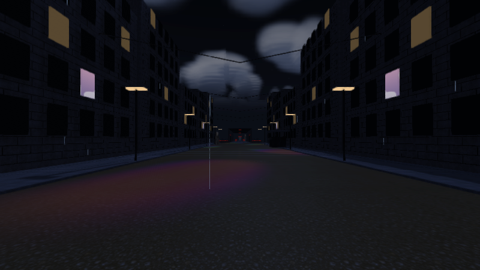
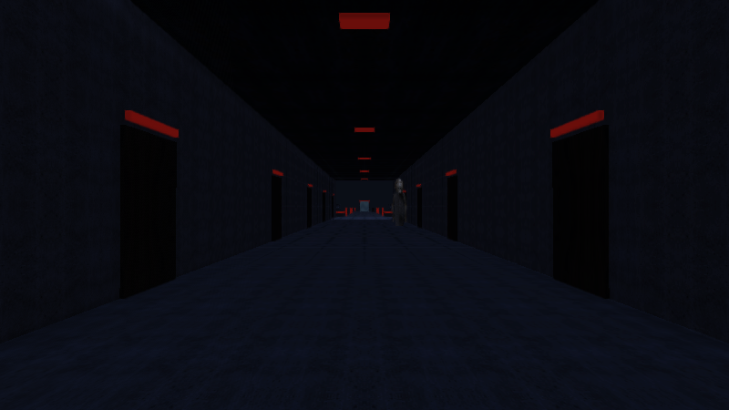
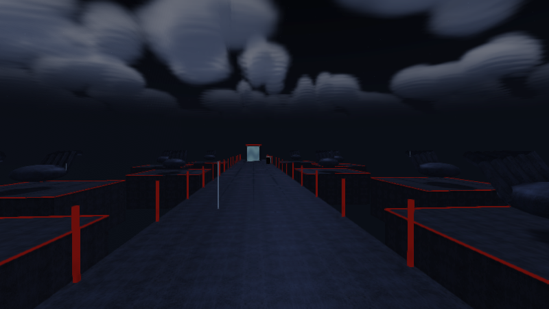

# Vistas del motor · 3.3

144 vistas calculadas con los modelos, materiales y shaders de producción mediante GLES2/Mesa. Cubren los 63 mundos en Estable y Esencial, además de seis encuadres en tres perfiles. Son renders del motor; no son capturas de un teléfono ni ilustraciones usadas para prometer otro acabado.

- [El inquilino](vistas34/inquilino.png)
- [El Umbral con el nuevo portal](vistas34/umbral.png)
- [Lluvia en el bosque](vistas34/bosque.png)
- Calle: [Estable](vistas34/calle_estable.png), [Esencial](vistas34/calle_esencial.png).
- Corredor: [Estable](vistas34/corredor_estable.png), [Esencial](vistas34/corredor_esencial.png).

La interfaz Android se compiló y revisó por código; estas imágenes de escritorio muestran el mundo 3D, no una ejecución de sus menús en un teléfono físico.
