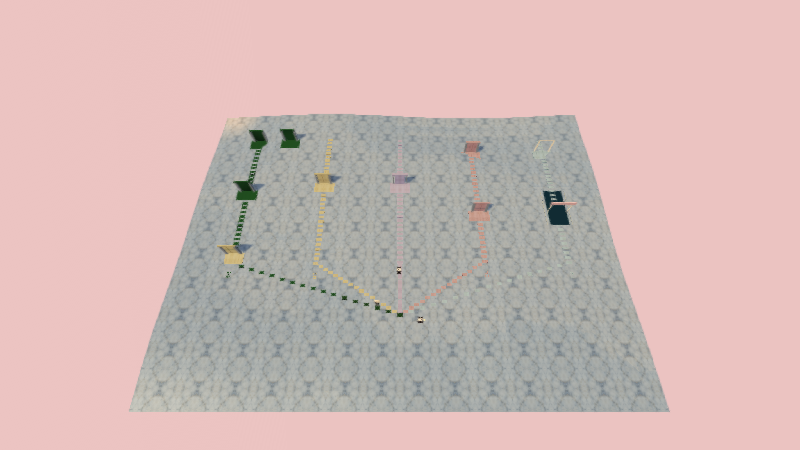
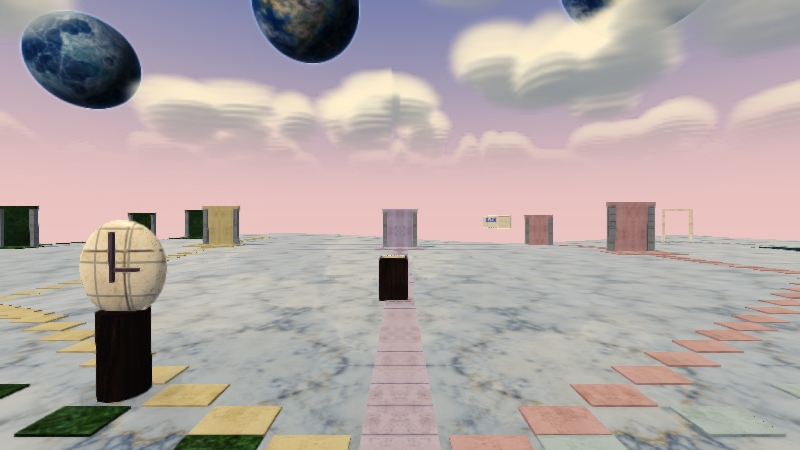
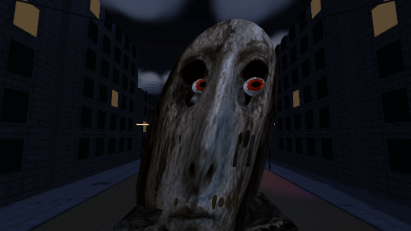
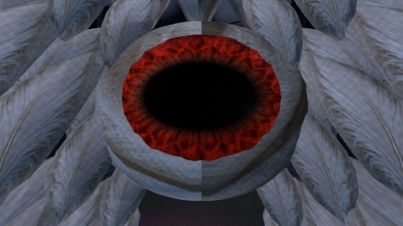
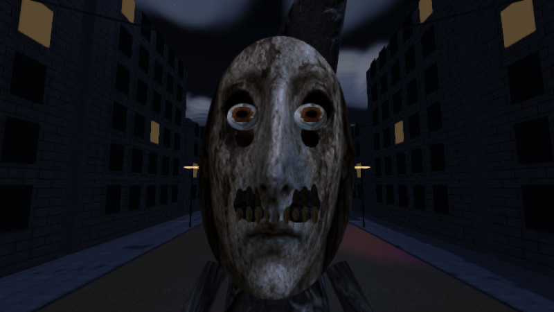
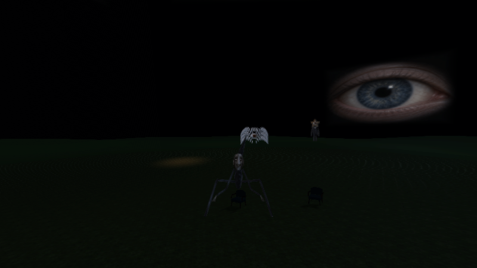

# Vistas del motor · DreamCore 3.4

Renders reales de la geometría y los shaders del juego mediante GLES2/Mesa. Las poses muestran el modelo en reposo o furia; no son capturas de un teléfono ni de la interfaz Android.

[Contenido y comportamiento](UMBRALES_Y_FURIA_3_4.md) · [Validación](VALIDACION_3_4.json).
