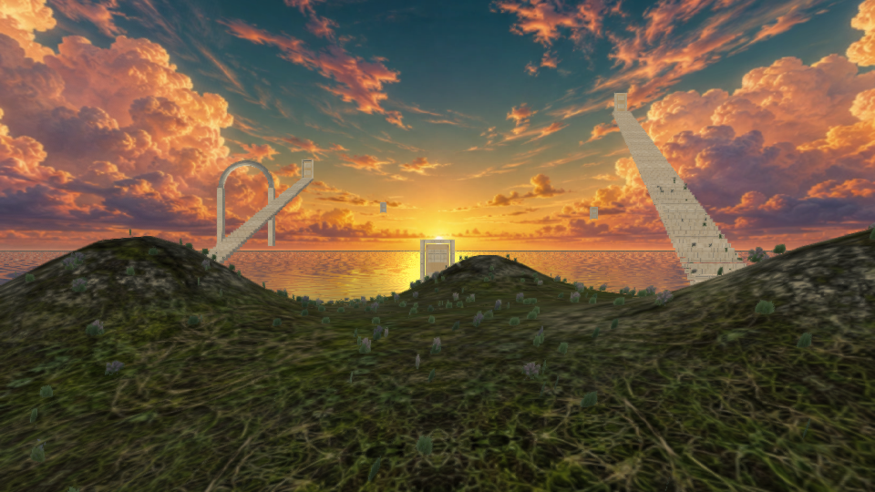
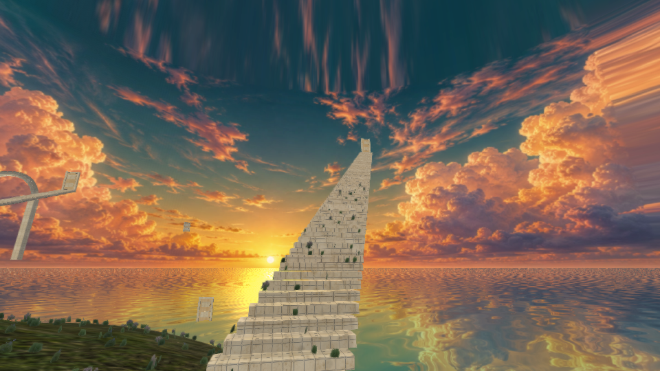
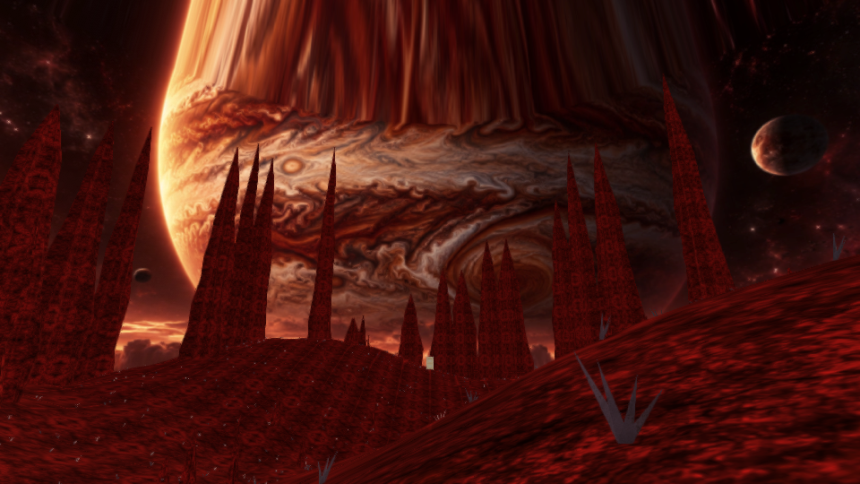
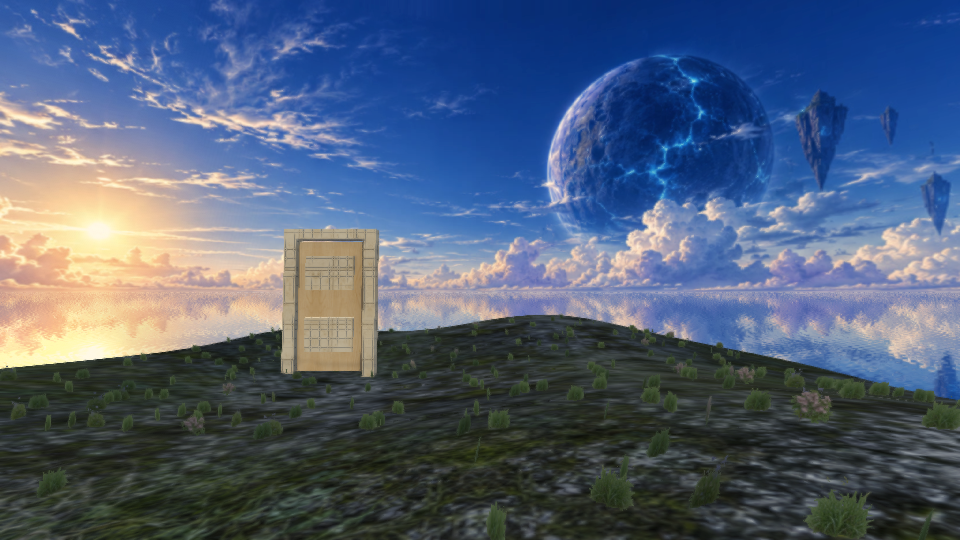
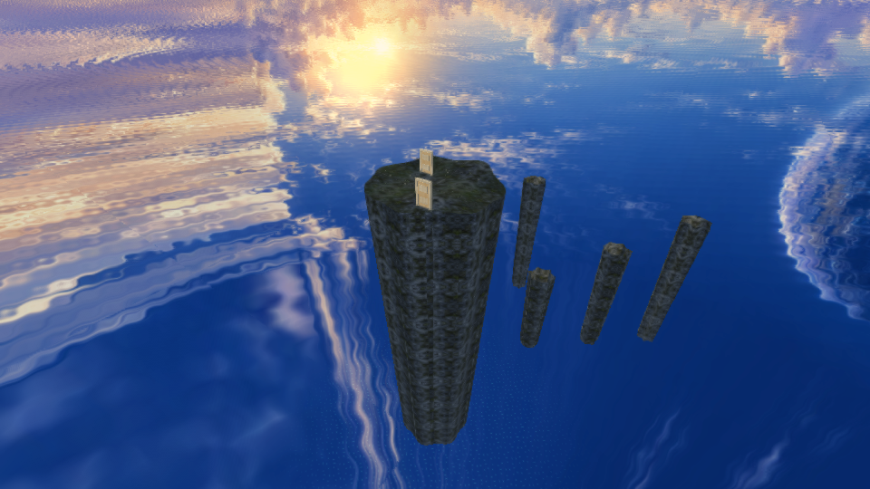
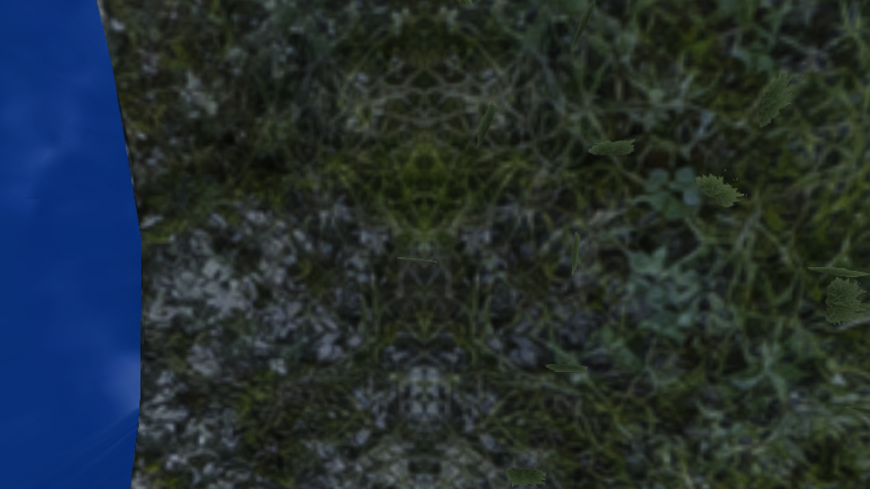

# Vistas del motor · DreamCore 3.5

Renders directos GLES2/Mesa de las geometrías y shaders de la aplicación. Cielo y planetas usan los panoramas originales de esta versión. No son capturas de un teléfono ni incluyen la interfaz Android.

[Cómo entrar y saltar](LOS_TRES_HORIZONTES_3_5.md) · [Validación](VALIDACION_3_5.json).
