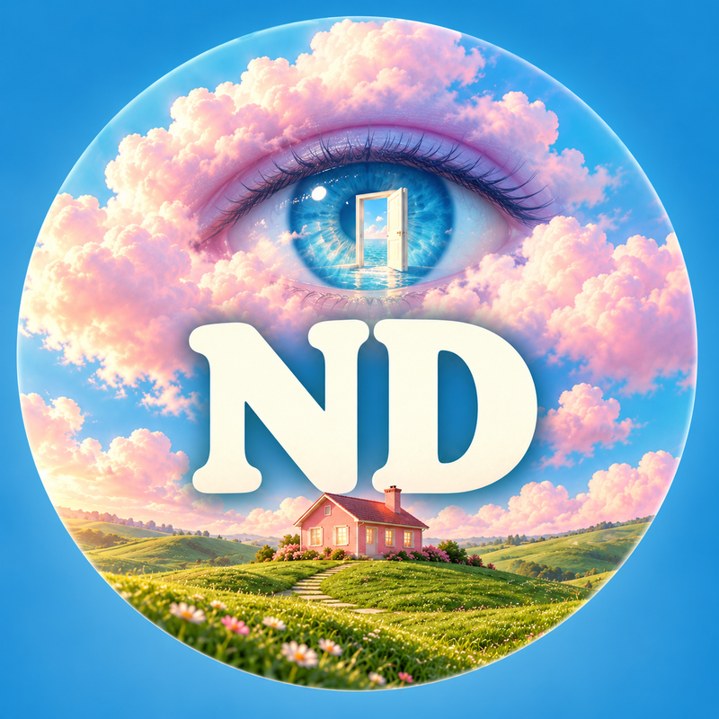
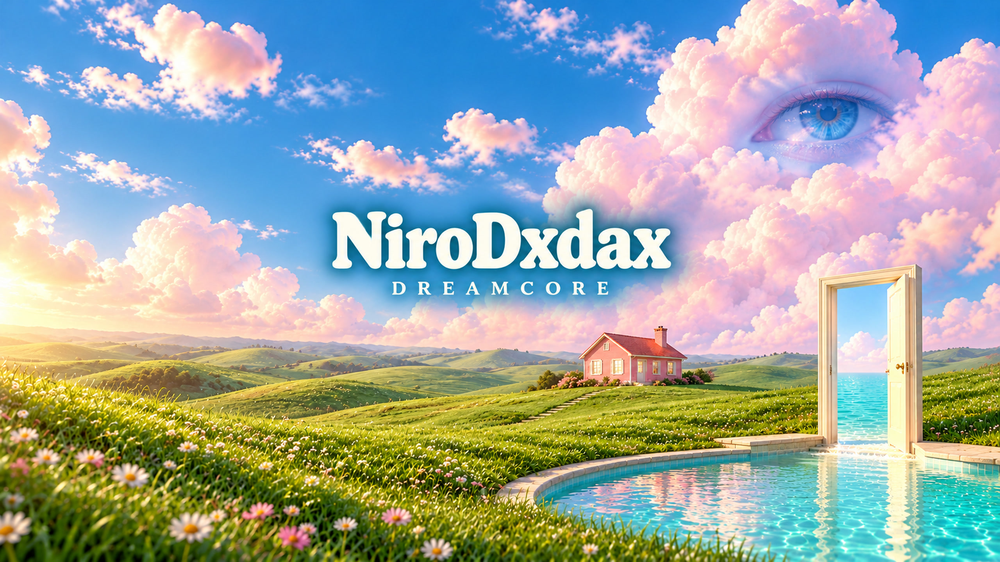
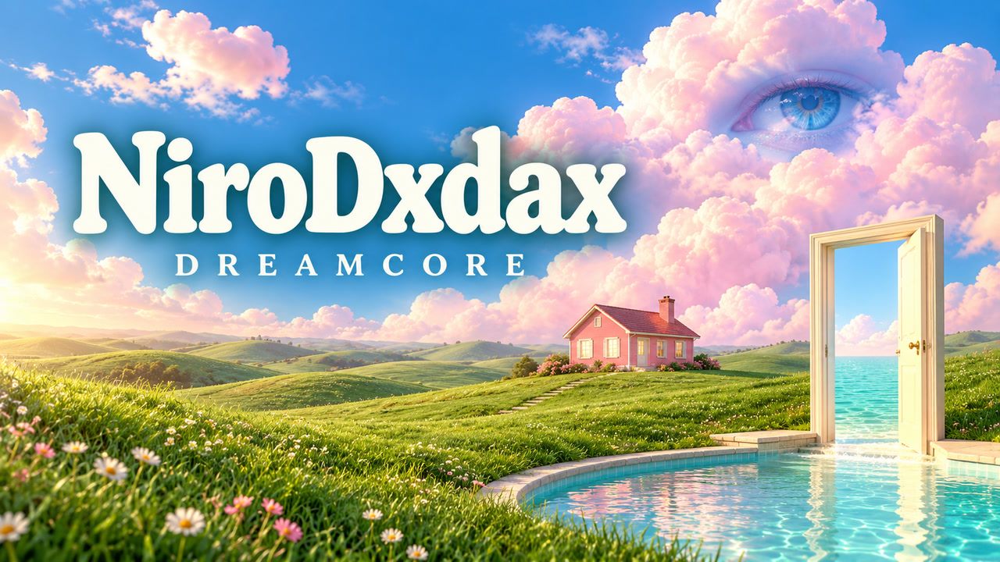
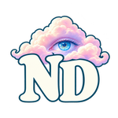
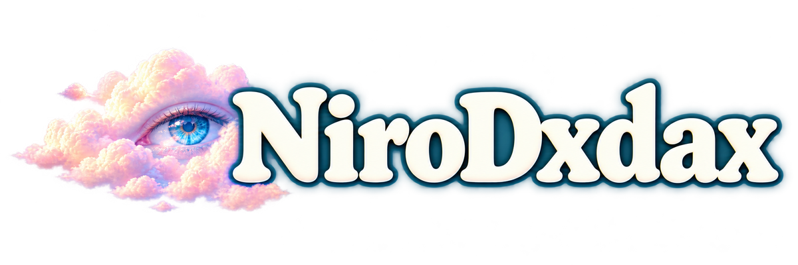
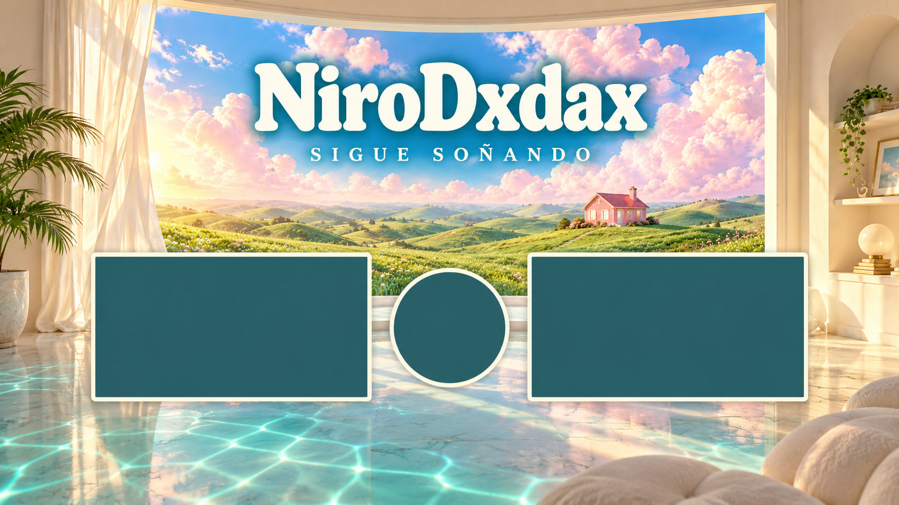
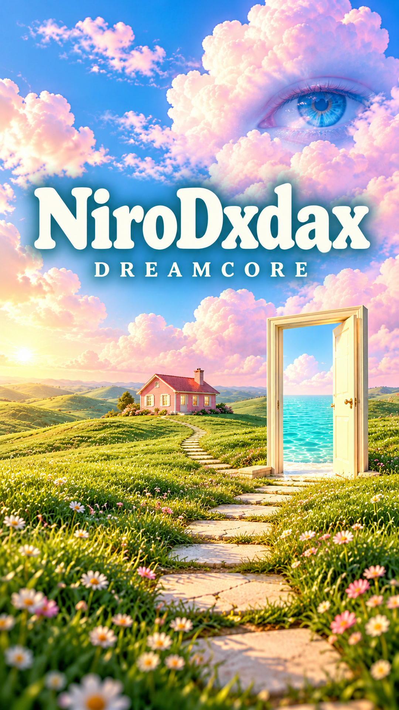

# NiroDxdax · Identidad Dreamcore para YouTube

[Descargar todo el kit](https://github.com/DxdaxNiro1/dxdaxd/raw/refs/heads/main/NiroDxdax_Kit_YouTube_Dreamcore.zip). Incluye archivos listos para subir, originales PNG y guía.

## Foto de perfil

800 × 800. Sube esta imagen como foto del canal. El monograma ND queda en el centro del recorte circular.

## Banner del canal

2560 × 1440. Sube como banner del canal. El nombre está centrado para mantenerse visible en el recorte de móvil.

## Miniatura de video

1280 × 720. Miniatura horizontal para videos de Dreamcore. Lleva el nombre completo NiroDxdax.

## Marca de agua de YouTube

150 × 150. PNG transparente para el apartado de marca de agua en Personalización de YouTube Studio. Elige mostrarla durante todo el video si lo prefieres.

## Marca de agua para edición

1200 × 400. PNG transparente con NiroDxdax. En CapCut u otro editor, añádelo como superposición sobre tu video, reduce su tamaño y ajusta la opacidad aproximadamente al 35–60%.

## Pantalla final

1920 × 1080. Pon esta imagen al final de tu edición. Los marcos son espacios para ubicar las tarjetas de videos y el círculo de suscripción con las herramientas de pantalla final de YouTube Studio.

## Portada vertical para Shorts

1080 × 1920. Imagen vertical para usar como portada o fotograma dentro de tu edición de Shorts. La forma de elegir la miniatura depende de las opciones que muestre YouTube en tu dispositivo.

