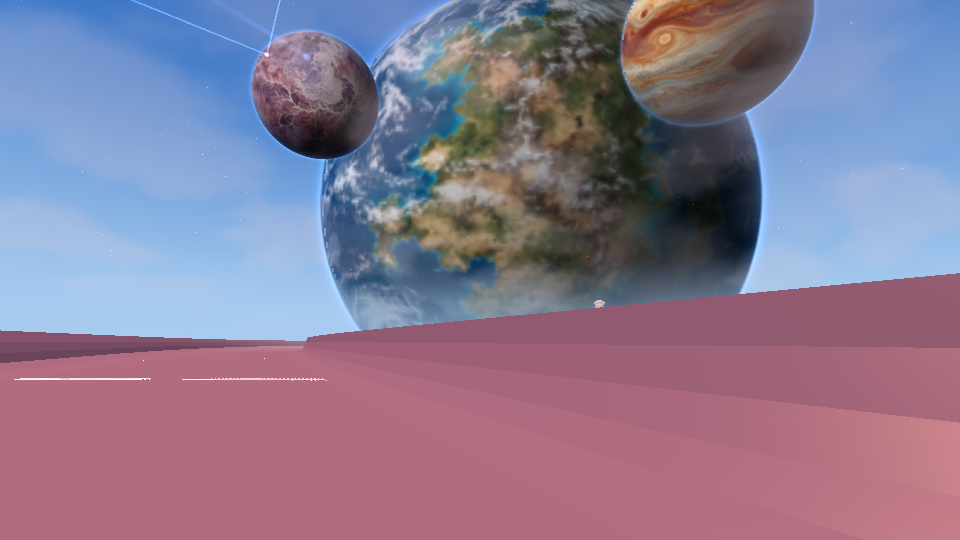
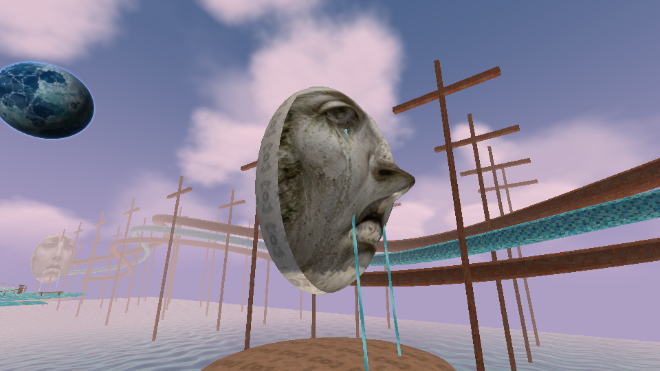
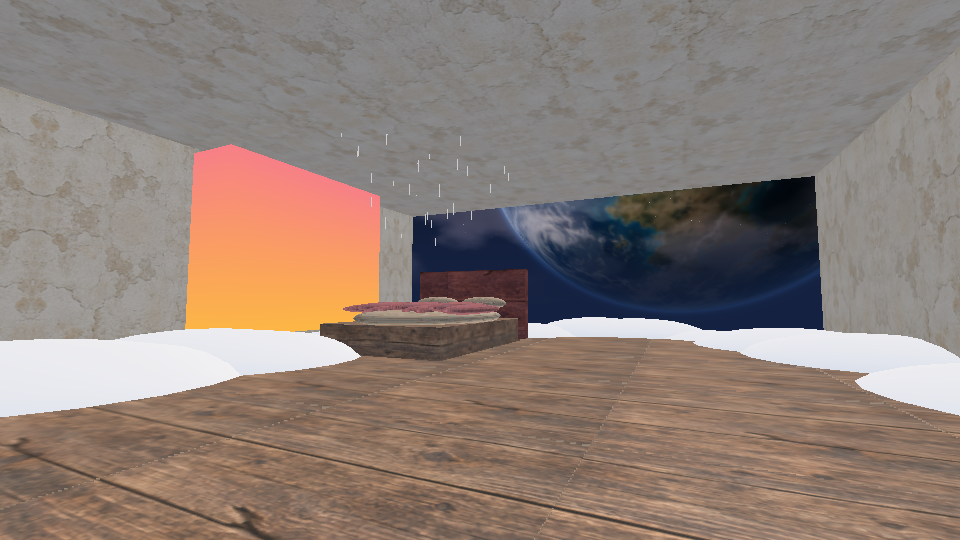
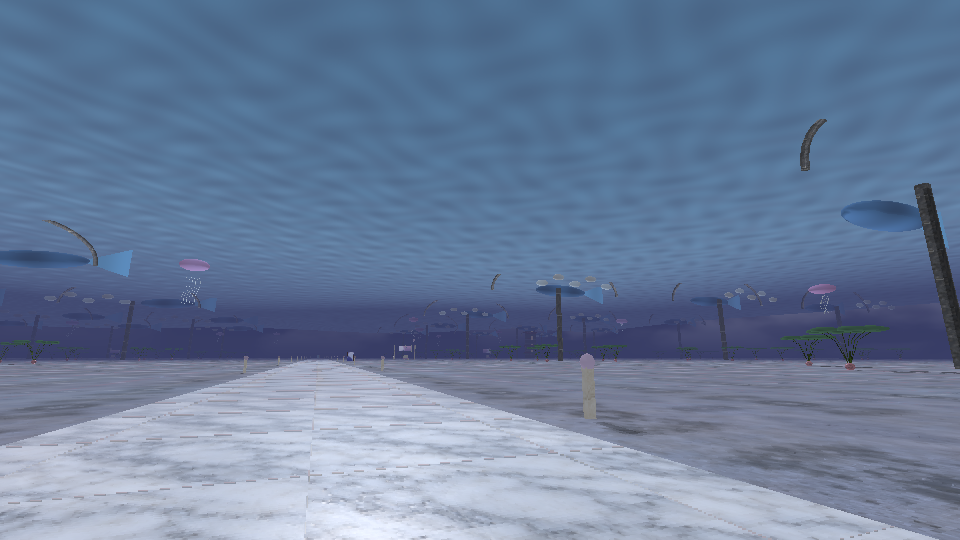
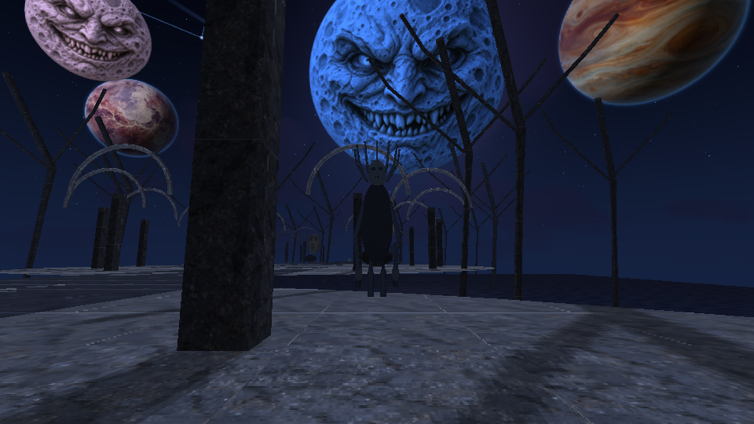
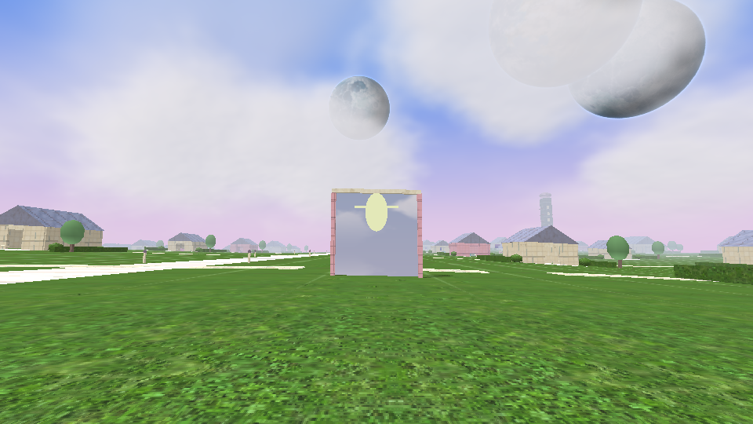

# DreamCore 1.9 — Horizontes imposibles

[**Descargar actualización 1.9 para tu juego actual**](https://github.com/DxdaxNiro1/dxdaxd/raw/refs/heads/main/DreamCore_1_9_Horizontes.zip)

[**Descargar proyecto completo 1.9 para Android Studio**](https://github.com/DxdaxNiro1/dxdaxd/raw/refs/heads/main/DreamCore_1_9_Proyecto_Completo.zip)

Planetas con océanos, continentes, hielo y bandas de gas; atmósfera, rotación, eclipses suaves y constelaciones. Tres mundos principales nuevos: tobogán entre nubes, ciudad del último recreo (escuela, centro comercial, cancha y fiesta vacíos) y jardín de las coronas de Dark Fantasy. Dos sueños secretos nuevos: cama cósmica y torre alcanzable mediante cuatro pistas fotográficas.

Cámara con fotos reales del renderizado, figuras que aparecen en las fotos y álbum interno de doce imágenes. Compañero invisible, segunda taza, puerta que se abre, piano en una habitación vacía y encuentro de una figura que sube al autobús. Presencias modeladas con más detalle, que observan y mantienen distancia.

Parque de tuberías ampliado a unos 610 m, cabezas con relieve esculpido continuo y agua desde los ojos. Mar del cielo con olas amplias, arcos, peces, medusas y jardines. Los interiores repetidos se reúnen en una estación final con cúpula, reloj, llave y recuerdos; permanece un único tren sumergido secreto. Se conserva piscina y abismo primero. Trece etapas principales y dos de Dark Fantasy, más cinco sueños secretos.

Cinco músicas originales nuevas, piano ambiental, nieve interior, lluvia localizada y nube en el centro comercial. Las partidas de la 1.8 se conservan con migración segura de los espacios remodelados. Sigue el evento lunar de los 120 segundos. El motor permanece en GLES2 y la geometría es estilizada; no se promete fotorrealismo ni FPS de un móvil.

**Actualizar:** extrae todo y ejecuta Instalar_Windows.cmd, que crea respaldo antes de copiar. **Proyecto completo:** abre DreamCore en Android Studio. Conserva tu identificador y firma para actualizar la app sin perder datos. [Instalación y cambios](DreamCore_1_9_Horizontes/LEEME.md) · [Recorrido y spoilers](DreamCore_1_9_Horizontes/RECORRIDO_CON_SECRETOS.md).

APK 1.9 real compilado y verificado, **2.927 comprobaciones**, diez enlaces GLES2 normales/mediump, seis OGG nuevos decodificados sin clipping y fuentes cotejadas con la compilación. Las vistas son del GLSL y geometría reales en Mesa/GLES2, sin HUD. Falta probar ejecución, controles, cámara/álbum, sonido y rendimiento en teléfono, además del instalador en Windows. [Validación](DreamCore_1_9_Horizontes/VALIDACION.json).

## Vistas renderizadas en la nube

| Vista normal | Fotografía con señal oculta |
| --- | --- |
|  |  |

[Versión 1.8 anterior](https://github.com/DxdaxNiro1/dxdaxd/raw/refs/heads/main/DreamCore_1_8_Proyecto_Completo.zip).
