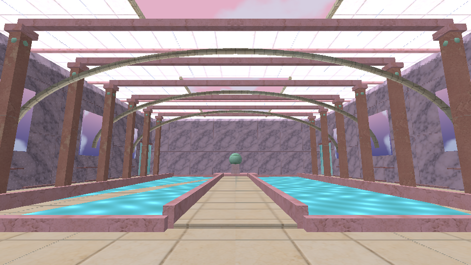
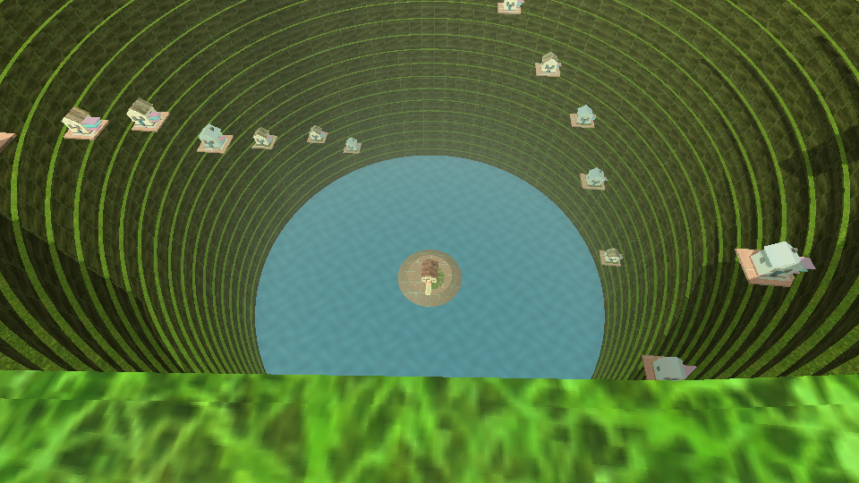
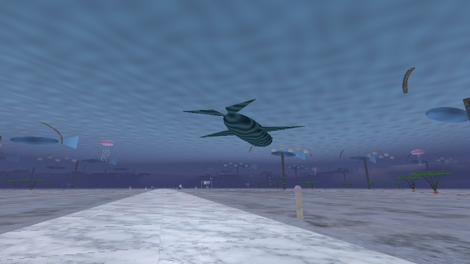
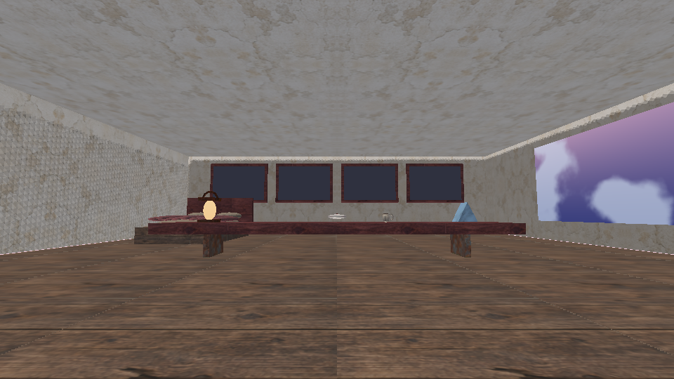

# DreamCore 2.0 — Los lugares que te recuerdan

[**Descargar actualización 2.0 para tu juego actual**](https://github.com/DxdaxNiro1/dxdaxd/raw/refs/heads/main/DreamCore_2_0_Recuerdos.zip)

[**Descargar proyecto completo 2.0 para Android Studio**](https://github.com/DxdaxNiro1/dxdaxd/raw/refs/heads/main/DreamCore_2_0_Proyecto_Completo.zip)

Refugio con cuatro marcos para tus fotografías; entrada a cuatro recuerdos quietos desde el álbum; linterna, brújula y prisma; cartero sin rostro con tres cartas; camino que se curva hasta una pared vertical y criatura enorme bajo el mar del cielo. Piscina con arcos y ventanas, abismo con distribución de casas según la semilla guardada, móviles elevados diferentes y constelación retirada. Siete músicas originales nuevas y voz grave de la criatura.

Modo inicial a 30 FPS, opción de 60 y límite térmico de 24 cuando Android avisa de calor elevado. Menús detienen el renderizado, bloques fuera de cámara se descartan, sombras estáticas se reutilizan, reflejos adaptan su frecuencia y el cielo se calcula tras los sólidos. Se mantienen los mapas, texturas e iluminación de la calidad elegida. El calentamiento real y los FPS requieren comprobarse en tu Infinix NOTE 50s.

**Actualizar:** extrae todo y ejecuta Instalar_Windows.cmd, que crea respaldo. **Proyecto completo:** abre la carpeta DreamCore en Android Studio. Conserva tu identificador y clave de firma, sin desinstalar la app. Lee guardados 1.8/1.9 y conserva los progresos. [Instalación y novedades](DreamCore_2_0_Recuerdos/LEEME.md) · [Ubicaciones y secretos](DreamCore_2_0_Recuerdos/RECORRIDO_CON_SECRETOS.md) · [Validación](DreamCore_2_0_Recuerdos/VALIDACION.json).

APK 2.0 compilado y firma verificada; **8.237 comprobaciones**, diez enlaces de shaders y ocho OGG nuevos validados sin clipping. En la comparación del cielo antes/después se conservaron los 518.400 píxeles; el descarte de bloques y la búsqueda BVH tienen pruebas contra referencias.

Las vistas son renders de geometría y GLSL reales en GLES2/Mesa, sin HUD. La compilación y pruebas se ejecutan en nube; queda probar ejecución, álbum, controles, sonido y temperatura en teléfono e instalador en Windows.

[Proyecto completo 1.9 anterior](https://github.com/DxdaxNiro1/dxdaxd/raw/refs/heads/main/DreamCore_1_9_Proyecto_Completo.zip).
