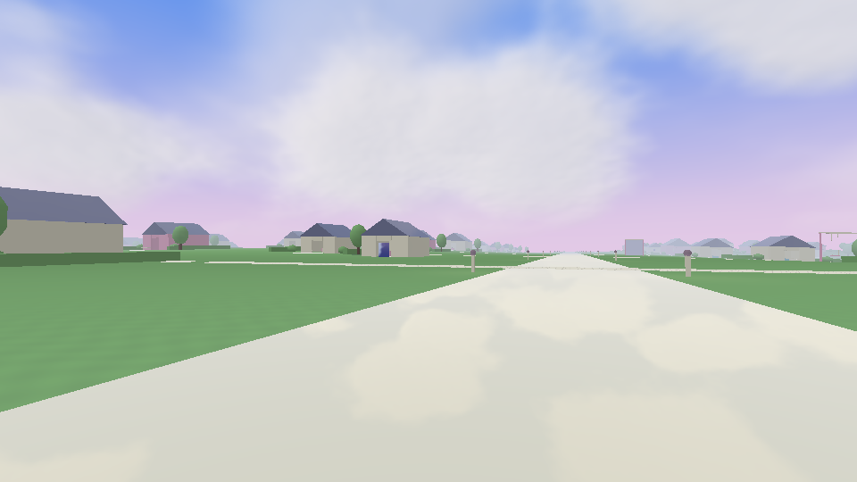
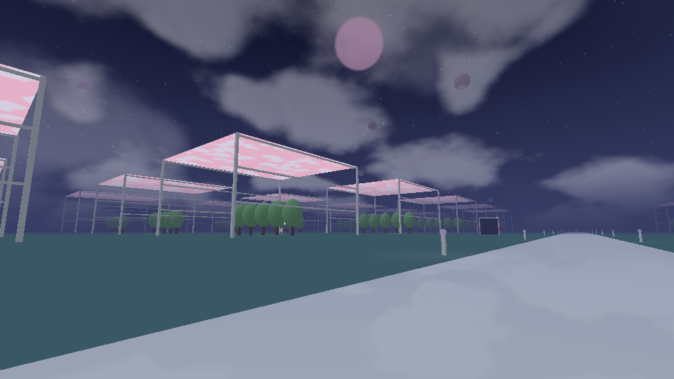
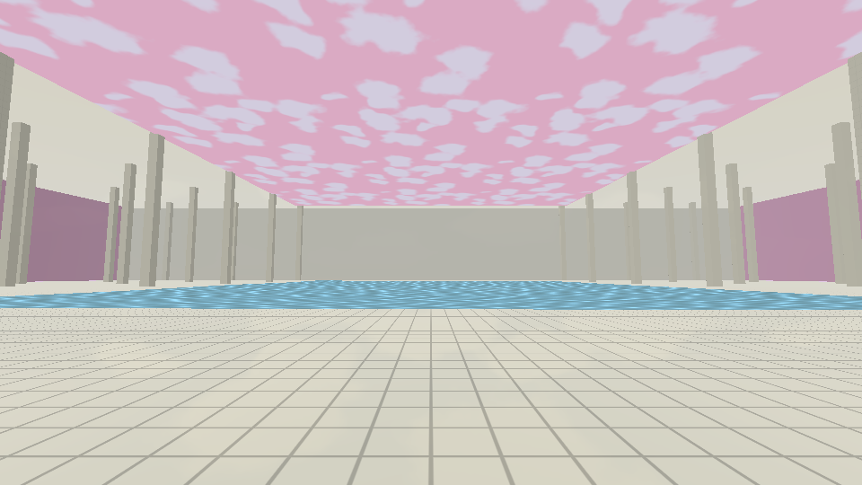
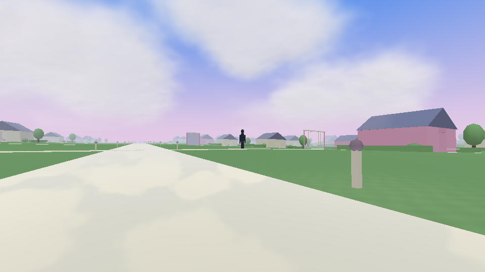

# DreamCore 1.6 — Sueños sin medida

[**Descargar actualización 1.6 para tu proyecto actual**](https://github.com/DxdaxNiro1/dxdaxd/raw/refs/heads/main/DreamCore_1_6_Suenos.zip)

[**Descargar proyecto completo 1.6 para Android Studio**](https://github.com/DxdaxNiro1/dxdaxd/raw/refs/heads/main/DreamCore_1_6_Proyecto_Completo.zip)

La piscina y el hoyo conservan su geometría y su lugar como etapas 1 y 2. Se reconstruyeron los nueve mundos siguientes: valle de agua, invernadero estelar, pueblo, casa cambiante, mar suspendido, ajedrez, hotel, carretera nocturna y estación final. Dreamcore sigue conectado de uno en uno, y Dark Fantasy conserva su portal independiente y sus lunas.

Los exteriores renovados tienen unos 760 × 775 m transitables. El pueblo tiene 73 casas con interiores sencillos, jardines, calles, relieve suave y columpios. Una casa pequeña lleva a una piscina imposible de otra escala y permite volver al pueblo. Hay 23 descubrimientos, puertas ocultas, sonidos lejanos, una figura que reacciona a la mirada, ventanas que cambian al regresar y orientación hacia el siguiente umbral.

Cuatro espejos reflejan la escena con una cámara reflejada. Nubes en dos capas con vientos independientes, grandes masas en pueblo/hotel, estrellas que titilan y cuerpos luminosos que se desplazan en ciertos mapas. Luz leve en el suelo y carga de geometría cercana por zonas. Los mundos son finitos y el estilo es procedural y onírico.

13 temas musicales nuevos y originales con frases, notas, instrumentos y pausas diferentes. Fundidos entre mundos, capas ambientales por zona, pasos de hierba/madera/piedra/baldosa/agua y ecos interiores. No se extrajo música de los videos.

**Proyecto completo:** Android Studio → Open → carpeta DreamCore (donde está settings.gradle.kts). **Actualización:** extraer todo y ejecutar Instalar_Windows.cmd, que respalda los archivos antes de copiar. [Instrucciones, ruta y límites](DreamCore_1_6_Suenos/LEEME.md).

APK real 1.6 compilado; firma, versión y recursos verificados. Pasaron **1.162 comprobaciones** de rutas, exploración, mallas y física; shaders y 13 vistas en GLES2/Mesa, incluyendo un pase de reflexión. Se comprobaron 23 archivos OGG decodificados sin clipping. Falta probar la ejecución y el rendimiento en teléfono y el instalador en Windows. [Validación](DreamCore_1_6_Suenos/VALIDACION.json).

## Vistas con geometría y shaders reales

Son renders sin HUD hechos en la nube; no capturas del teléfono.

Las versiones anteriores se conservan en el repositorio, incluida [la 1.5 completa](https://github.com/DxdaxNiro1/dxdaxd/raw/refs/heads/main/DreamCore_1_5_Proyecto_Completo.zip).
