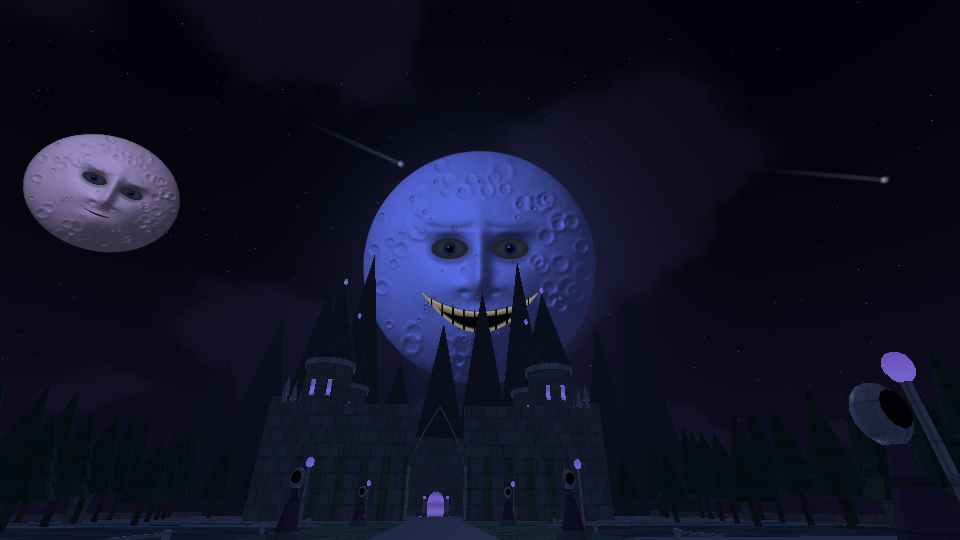
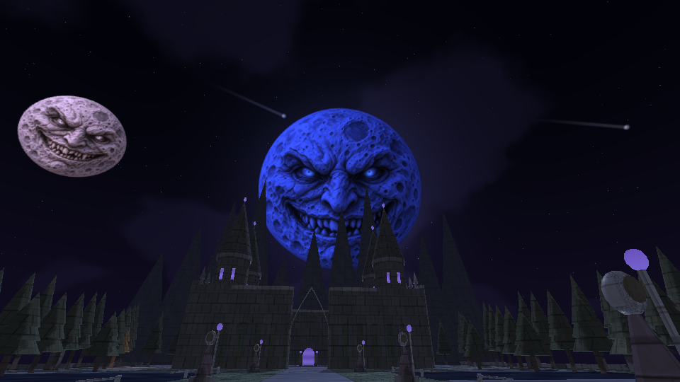
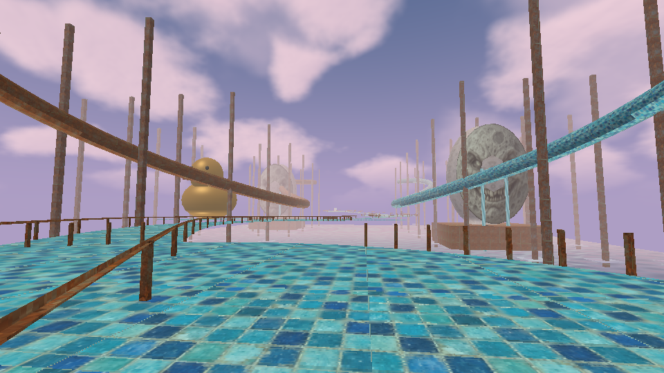
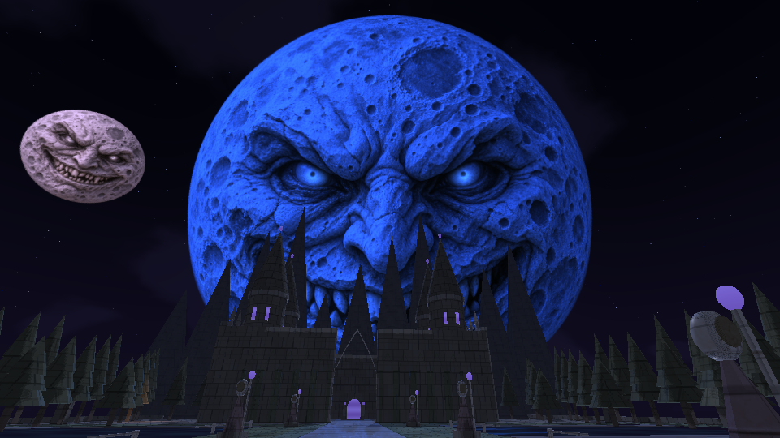
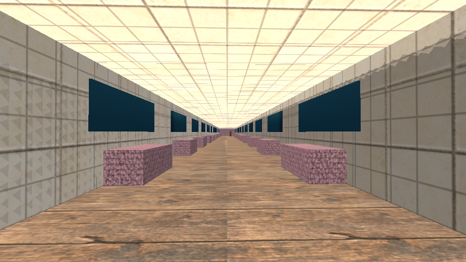
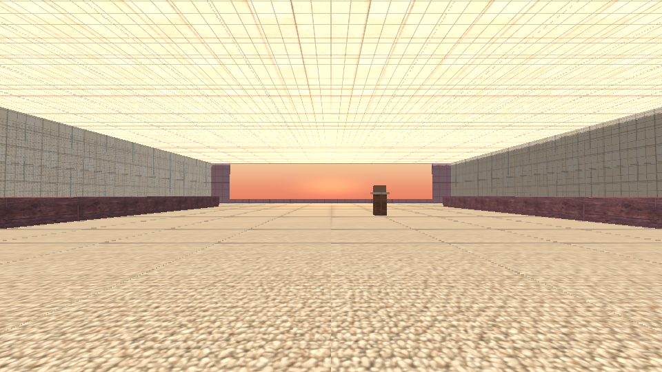

# DreamCore 1.8 — Ecos del sueño

[**Descargar actualización 1.8 para tu juego actual**](https://github.com/DxdaxNiro1/dxdaxd/raw/refs/heads/main/DreamCore_1_8_Ecos.zip)

[**Descargar proyecto completo 1.8 para Android Studio**](https://github.com/DxdaxNiro1/dxdaxd/raw/refs/heads/main/DreamCore_1_8_Proyecto_Completo.zip)

Guardado automático de mapa, posición, recuerdos, decisiones y descubrimientos; objetos interactivos con consecuencias entre mundos; tres sueños secretos con retorno; tres epílogos; figuras con comportamientos distintos; fenómenos espaciados y ajustes de sensibilidad, música, ambiente y calidad.

El nuevo parque de las lágrimas se inspira en las pasarelas, mosaicos, grandes rostros y pato del vídeo. La ruta Dreamcore tiene doce etapas y mantiene piscina y abismo al principio. Dark Fantasy conserva su portal aparte. Se añaden cuatro músicas originales distintas, ambiente interior hueco, radio y cuatro notas de un misterio compartido.

Materiales más detallados, relieve de iluminación, rugosidad, sombras direccionales en calidad media/alta y nueva luna de roca esculpida que conserva su animación y el evento de dos minutos. El motor sigue siendo GLES2 y la geometría es estilizada; no se promete fotorrealismo completo.

**Para actualizar:** extrae todo el ZIP y ejecuta `Instalar_Windows.cmd`; crea respaldo antes de copiar. **Proyecto completo:** abre la carpeta `DreamCore` en Android Studio. [Instalación y cambios detallados](DreamCore_1_8_Ecos/LEEME.md) · [Recorrido con spoilers](DreamCore_1_8_Ecos/RECORRIDO_CON_SECRETOS.md).

APK Android 1.8 compilado y verificado; **1.847 comprobaciones** y diez enlaces de shaders GLES2 normales/mediump. Diez OGG nuevos decodificados sin clipping. Fuentes cotejadas con la compilación. Falta probar ejecución, controles y rendimiento en un teléfono y ejecutar el instalador en Windows. [Validación](DreamCore_1_8_Ecos/VALIDACION.json).

## Comparación de la luna

Mismo ángulo y estado de observación, renderizados con el código de cada versión en la nube. Son vistas GLES2 sin HUD, no capturas de un teléfono.

| 1.7 | 1.8 |
| --- | --- |
|  |  |

## Vistas de la 1.8

La [versión 1.7 anterior](https://github.com/DxdaxNiro1/dxdaxd/raw/refs/heads/main/DreamCore_1_7_Proyecto_Completo.zip) sigue disponible.
