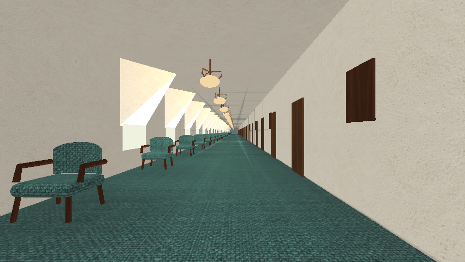
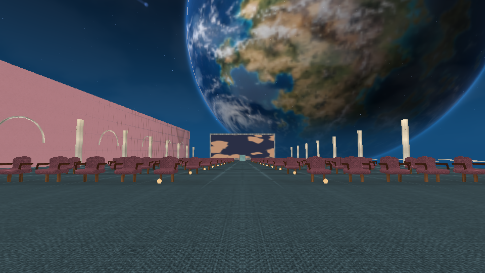
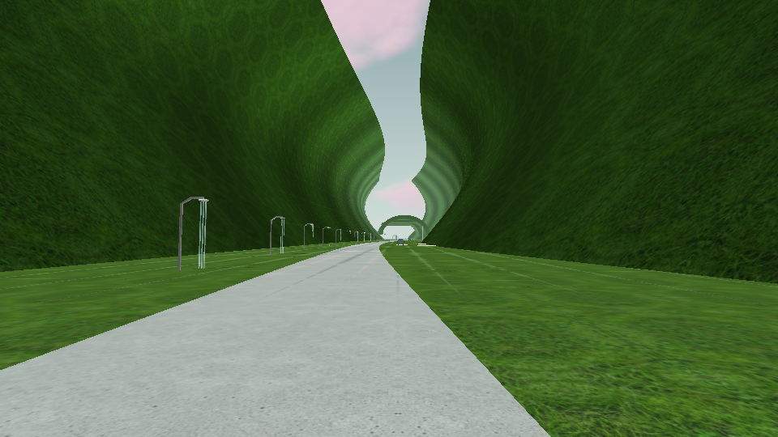
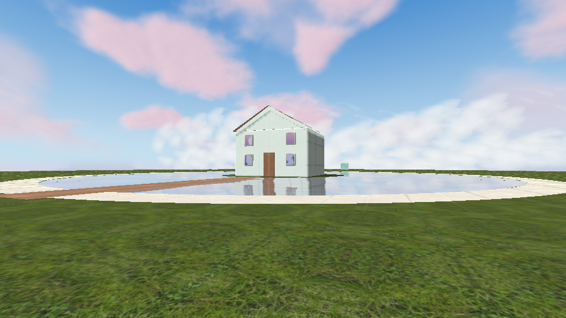
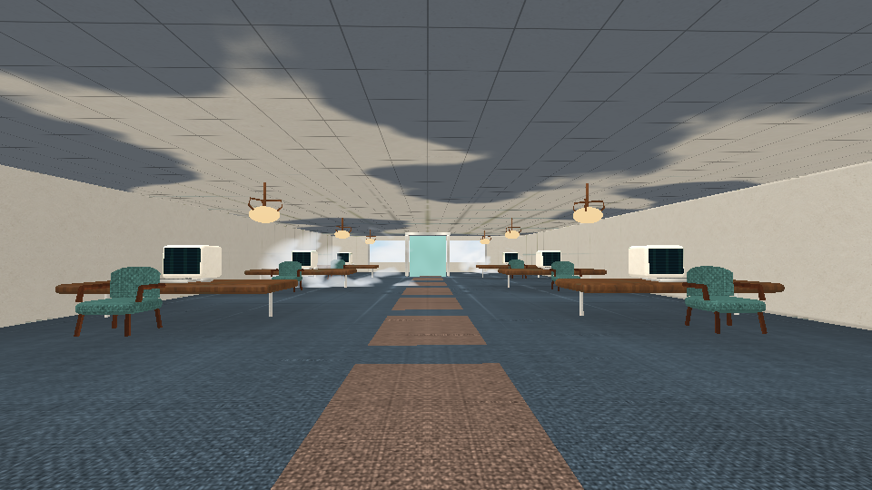

# DreamCore 2.1 — Los lugares imposibles

[**Descargar actualización 2.1 para tu juego actual**](https://github.com/DxdaxNiro1/dxdaxd/raw/refs/heads/main/DreamCore_2_1_Arquitecturas.zip)

[**Descargar proyecto completo 2.1 para Android Studio**](https://github.com/DxdaxNiro1/dxdaxd/raw/refs/heads/main/DreamCore_2_1_Proyecto_Completo.zip)

Once mundos nuevos conectados: barrio inclinado, cine sobre la Tierra, valle de duchas y piscinas, casa reflejada en un lago entre nubes, canal de hongos, colina con casa rosa, gasolinera aislada, suburbio pastel, pasillo de sillas, atrio blanco y oficina entre nubes.

Sillas curvas, biseles, lámparas, computadoras CRT, surtidores con mangueras y roca modelada como una superficie continua. Nueva lámina de materiales con relieve/rugosidad derivada, coordenadas de textura continuas, iluminación local calculada al construir interiores, reflejo plano del lago y nubes suaves. Once músicas originales nuevas. También cambian los materiales globales, varias sillas antiguas y la vegetación del pueblo.

**Entrada:** Ajustes → Los lugares imposibles · 11 mundos; también por la puerta central del fondo del Umbral o desde el refugio. Puedes volver por las puertas y al terminar regresas al punto de entrada. Conserva la ruta Dreamcore y Dark Fantasy anterior, herramientas, álbum y progreso.

**Instalar:** extrae el ZIP de actualización y ejecuta Instalar_Windows.cmd en tu PC; crea respaldo. Para el proyecto completo abre DreamCore en Android Studio. Conserva tu identificador y clave de firma sin desinstalar la aplicación. [Instalación y novedades](DreamCore_2_1_Arquitecturas/LEEME.md) · [Recorrido](DreamCore_2_1_Arquitecturas/RECORRIDO_CON_SECRETOS.md) · [Validación](DreamCore_2_1_Arquitecturas/VALIDACION.json).

APK 2.1 compilado y firma verificada; **9.098 comprobaciones**, diez enlaces GLES2, once OGG nuevos decodificados sin clipping y veinte vistas del motor. Se comprobaron recorridos, alturas, guardados, modelos y los cambios de imagen al activar el reflejo del lago y avanzar la animación de la oficina.

Mantiene 30 FPS como objetivo inicial, opción de 60, control térmico y descarte de geometría fuera de cámara. Las vistas son renders reales de geometría y GLSL en Mesa/GLES2. La geometría sigue siendo estilizada; FPS, temperatura, sonido y ejecución deben verificarse en el teléfono, y el instalador en Windows.

[Proyecto completo 2.0 anterior](https://github.com/DxdaxNiro1/dxdaxd/raw/refs/heads/main/DreamCore_2_0_Proyecto_Completo.zip).
