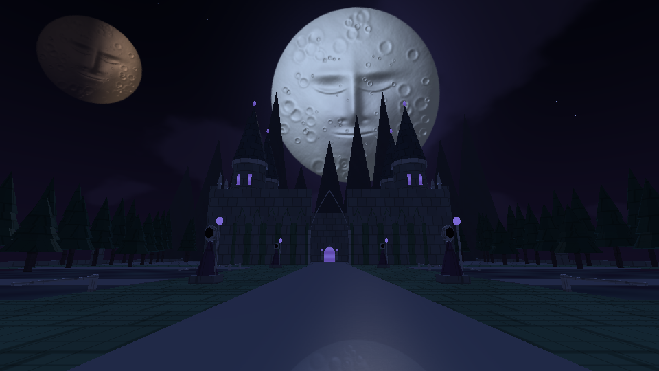
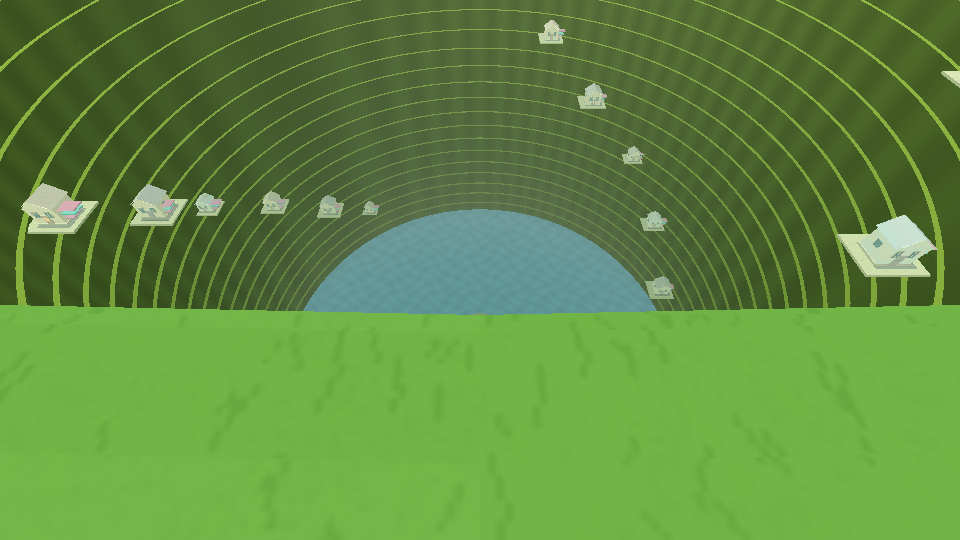
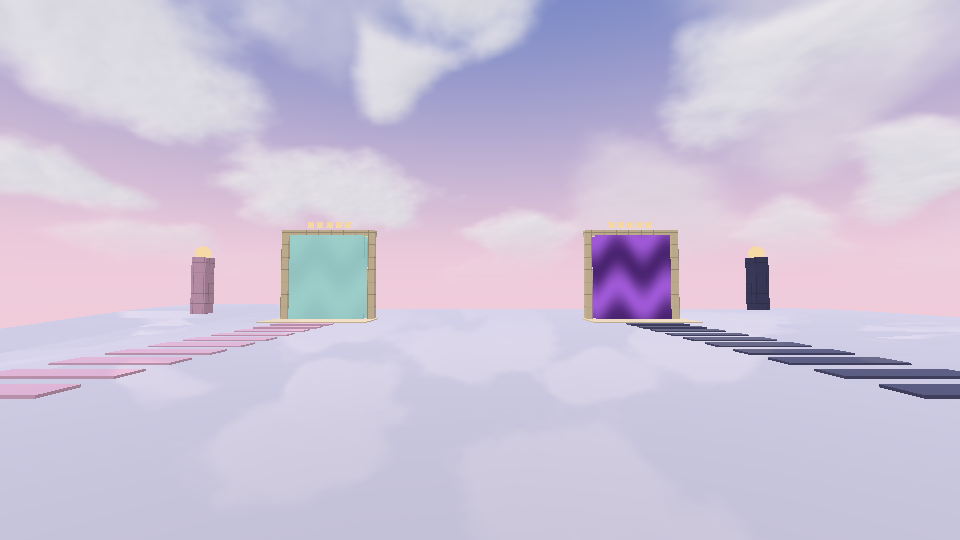

# DreamCore 1.5 — Umbrales y lunas dormidas

[**Descargar actualización 1.5 para tu proyecto actual**](https://github.com/DxdaxNiro1/dxdaxd/raw/refs/heads/main/DreamCore_1_5_Umbrales.zip)

[**Descargar proyecto completo 1.5 para Android Studio**](https://github.com/DxdaxNiro1/dxdaxd/raw/refs/heads/main/DreamCore_1_5_Proyecto_Completo.zip)

Al comenzar hay dos portales: **Dreamcore a la izquierda y Dark Fantasy a la derecha**. Dreamcore recorre sus once etapas una tras otra, desde las piscinas y el hoyo hasta una puerta final. Las entradas permiten volver a la etapa anterior.

El hoyo conserva 180 m de profundidad, ahora con paredes verdes y 23 repisas circulares inspiradas en la referencia del usuario. La casa central continúa hacia los túneles; al regresar apareces en la isla.

Dark Fantasy es una experiencia aparte con catedral, bosque, jardines inundados, figuras de piedra, una luna con rostro esculpido y otra en fase parcial. Tiene música ambiental original propia y regreso al Umbral. Sus figuras son esculturas; todavía no hay IA de enemigos o multijugador.

El proyecto completo puede abrirse directamente mediante Android Studio → Open → carpeta DreamCore. El paquete de actualización incluye instalador Windows con copia de seguridad y alternativa manual. [Instrucciones y recorrido](DreamCore_1_5_Umbrales/LEEME.md).

Compilación real de APK 1.5 y firma verificadas. Pasaron 774 comprobaciones de geometría, rutas y física; shaders y vistas reales en GLES2/Mesa. La música se comprobó numéricamente. Falta la prueba en teléfono y del instalador en Windows.

## Vistas renderizadas con los mapas y shaders reales

Los archivos de las versiones 1.2, 1.3 y 1.4 se conservan en el repositorio. [Proyecto base 1.3 completo](https://github.com/DxdaxNiro1/dxdaxd/raw/refs/heads/main/DreamCore_1_3_Proyecto_Completo.zip).
