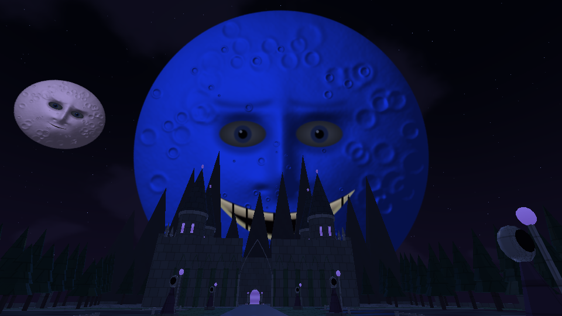
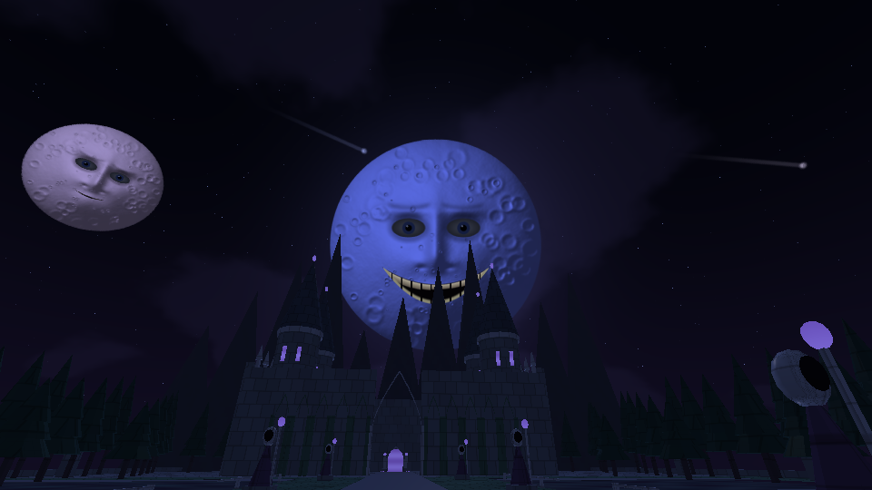
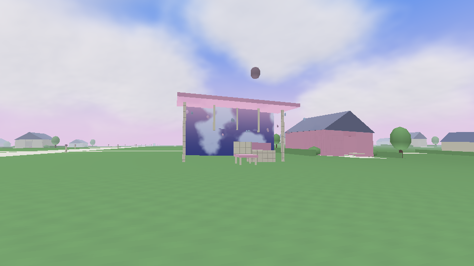

# DreamCore 1.7 — Lunas vivas

[**Descargar actualización 1.7 para tu proyecto actual**](https://github.com/DxdaxNiro1/dxdaxd/raw/refs/heads/main/DreamCore_1_7_Lunas_Vivas.zip)

[**Descargar proyecto completo 1.7 para Android Studio**](https://github.com/DxdaxNiro1/dxdaxd/raw/refs/heads/main/DreamCore_1_7_Proyecto_Completo.zip)

Carrera más rápida: 10,4 m/s al empezar a correr, hasta 12,4 m/s gradualmente en exteriores; 8,2 m/s en interiores y caminar a 4,2 m/s. El movimiento comprueba colisiones en tramos cortos. Pasos con tres variantes por suelo, más suaves, menos agudos y ecos discretos. Arriba a la derecha puedes elegir suaves, normales o silencio; la preferencia se guarda.

Las lunas de Dark Fantasy parpadean repetidamente, siguen tu posición con los ojos y amplían su sonrisa al mirarlas. Tras 120 segundos de observación durante una visita aparece una gran luna azul sonriente, inspirada en la referencia del usuario. Permanece y sigue animada. Apartar la vista más de dos segundos reinicia la vigilia; la pausa no la hace avanzar. Una luna tapada por la geometría no cuenta. Hay más estrellas, cometas recurrentes y dos capas ambientales suaves propias para la observación y la aparición. La cara es procedural y estilizada.

Dreamcore conserva sus once etapas, las 73 casas y las dimensiones de la 1.6. Añade nueve recuerdos opcionales, uno por cada mundo renovado, con paradas vacías, reloj, campana, teléfono, corona y máquina de billetes. Son 32 descubrimientos en total. Reunir los nueve cambia el mensaje final; no es obligatorio para terminar. Las pequeñas luces flotan, los árboles se mecen y los columpios se balancean.

Se mantienen la piscina y el hoyo como etapas 1 y 2 y el portal independiente de Dark Fantasy. Siguen los espejos, la piscina imposible, el cuarto oculto y las trece composiciones musicales originales. No se agrandaron otra vez los mapas.

**Actualización:** extrae todo y ejecuta Instalar_Windows.cmd, con respaldo antes de copiar. **Proyecto completo:** Android Studio → Open → carpeta DreamCore (donde está settings.gradle.kts). [Instrucciones y recorrido](DreamCore_1_7_Lunas_Vivas/LEEME.md).

APK real 1.7 compilado; firma, versión y recursos comprobados. **1.252 comprobaciones** de rutas, geometría, exploración, física, lunas y carrera. Shaders normales y mediump en GLES2/Mesa y vistas con los estados reales del controlador lunar. Los 17 nuevos OGG se decodificaron sin clipping. Falta probar la ejecución/rendimiento en móvil y el instalador en Windows. [Validación](DreamCore_1_7_Lunas_Vivas/VALIDACION.json).

## Vistas renderizadas con el código del juego

Renders en la nube, sin HUD; no capturas del teléfono. La vista de luna gigante muestra el estado del controlador tras los 120 segundos.

Las versiones anteriores siguen disponibles: [proyecto completo 1.6](https://github.com/DxdaxNiro1/dxdaxd/raw/refs/heads/main/DreamCore_1_6_Proyecto_Completo.zip).
