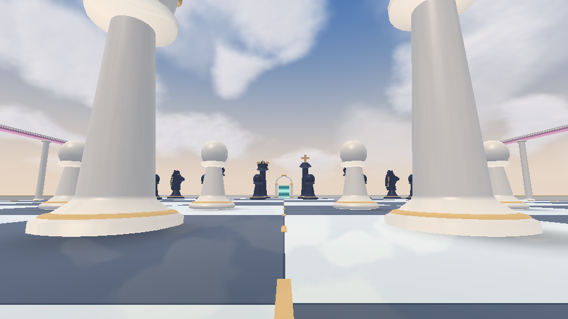
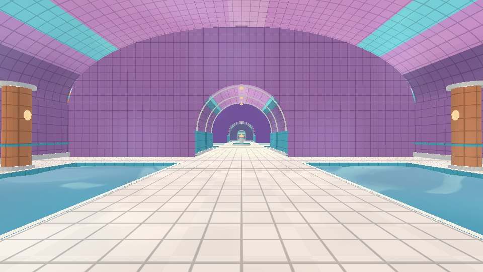
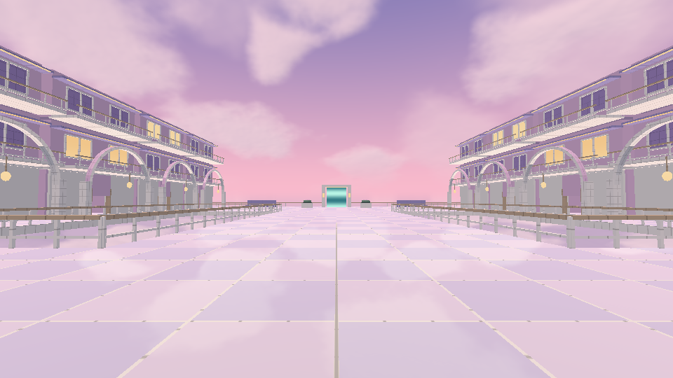
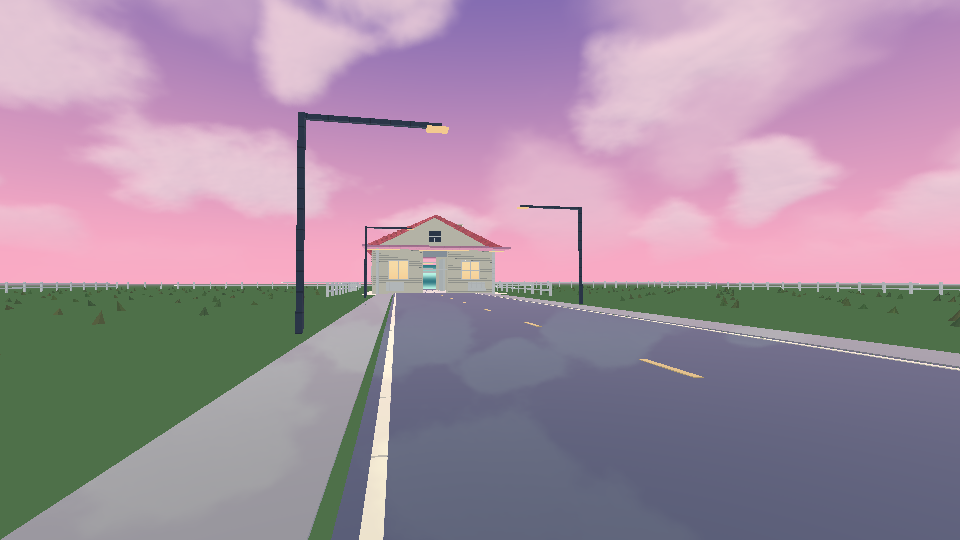

# DreamCore — actualizaciones Android

## DreamCore 1.4: Mundos que no terminan

[**Descargar actualización 1.4**](https://github.com/DxdaxNiro1/dxdaxd/raw/refs/heads/main/DreamCore_1_4_Mundos.zip)

Cuatro mapas nuevos inspirados en las referencias del usuario: ajedrez gigante, túneles de piscinas, hotel sobre nubes y carretera nostálgica. Doce mapas en total, cada uno con música ambiental original propia. Nubes suaves iluminadas que responden a la cámara, materiales pulidos y carga de un mapa por vez. Incluye las caídas y el regreso de la casa central del abismo 1.3.

Extrae todo el ZIP, abre `Instalar_Windows.cmd` e indica la carpeta de tu proyecto. Crea una copia de seguridad antes de actualizar. También hay [instrucciones manuales](DreamCore_1_4_Mundos/LEEME.md). Se deben instalar todos los 15 Kotlin, músicas y textura de nubes; conserva PlayerState y los recursos originales.

Los cuatro portales nuevos están en el jardín, al otro lado de la estación. Cada mapa permite regresar al inicio y pasar al siguiente.

Código Kotlin compilado, shaders enlazados y mapas renderizados en GLES2/Mesa. Pruebas de física, recorridos, suelo y audio correctas. No se generó APK ni se probó el teléfono o el instalador en Windows. Las nubes son una aproximación por capas, no una simulación volumétrica completa.

### Vistas con el mapa y shaders reales

Renderizados de escritorio sin interfaz táctil; no establecen rendimiento en el teléfono. Las carpetas 1.2 y 1.3 conservan las versiones anteriores.
