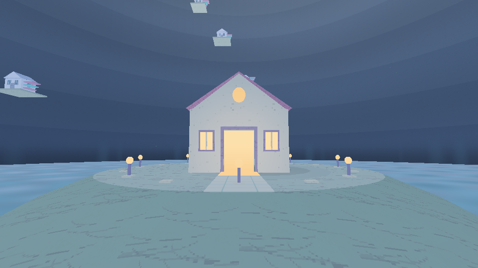
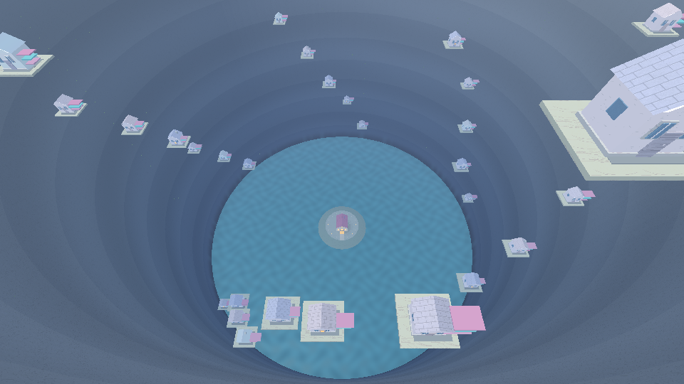

# DreamCore — actualizaciones Android

## Versión 1.3: El abismo vuelve a casa

[Descargar DreamCore 1.3](https://github.com/DxdaxNiro1/dxdaxd/raw/refs/heads/main/DreamCore_1_3_Abismo.zip)

Caída con gravedad, isla transitable, casa central con puerta para regresar a la estación, iluminación y sombras de contacto, agua y materiales mejorados, música ambiental original.

Extrae todo el ZIP y consulta [las instrucciones](DreamCore_1_3_Abismo/LEEME.md). Incluye instalador para Windows con copia de seguridad y alternativa manual. Hay que copiar ocho archivos Kotlin y dos sonidos, conservando los recursos y PlayerState del proyecto original.

Código Kotlin y shaders comprobados; 516 comprobaciones de física y rutas correctas. No es un APK compilado ni una prueba en teléfono.

### Vistas renderizadas

Estas imágenes usan el mapa, shaders y atlas reales en OpenGL ES2 de escritorio. No incluyen controles táctiles ni establecen el rendimiento del teléfono.

La carpeta DreamCore_1_2_Crater conserva la actualización anterior.
